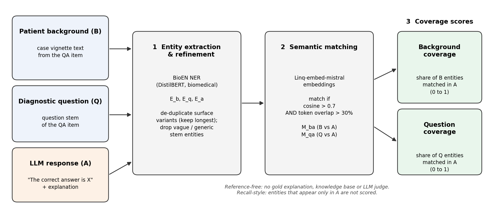

[Home](../) · [AI Papers](./)

# 答對選項，也講到病人的關鍵線索了嗎？EntQA 用實體覆蓋率評醫療問答 LLM：模型層級與準確率同向，逐題訊號很弱

## 來源

- 團隊：Boston University Faculty of Computing & Data Sciences；第一作者 Yi Liu，通訊作者 Vijaya B. Kolachalama（另屬 Boston University Chobanian & Avedisian School of Medicine 醫學系與 Department of Computer Science）。[(ref: main)](https://journals.plos.org/digitalhealth/article?id=10.1371/journal.pdig.0001752)
- 論文：*Entity-centric evaluation of large language model responses for medical question-answering tasks*，刊於 *PLOS Digital Health* 5(10): e0001752，2026-09-08 接受、2026-10-06 出版。[(ref: main)](https://journals.plos.org/digitalhealth/article?id=10.1371/journal.pdig.0001752)
- 識別碼：[DOI: 10.1371/journal.pdig.0001752](https://doi.org/10.1371/journal.pdig.0001752)
- 全文：[PLOS Digital Health 官方 HTML 全文](https://journals.plos.org/digitalhealth/article?id=10.1371/journal.pdig.0001752)，開放取用；程式碼與模型回答資料公開於 [GitHub vkola-lab/pdig2026](https://github.com/vkola-lab/pdig2026)。
- 研究性質：完整研究（非 pilot），核心方法已實作並在五個公開題庫上評估；沒有人工評分對照，驗證目標是選擇題答對與否及模型規模。
- 證據邊界：論文的計分公式與 Table 1–3 的多數儲存格以圖像呈現，本文只引用正文文字明列的數值；兩個覆蓋率分數在正文以符號指稱，本文依其文字描述對應為「背景覆蓋」與「問題覆蓋」。

**編輯：** Clare

這篇論文提出 EntQA，用「LLM 的回答保留了題目裡多少生醫實體」來評醫療問答，七個 Qwen 2.5 模型平均起來，它和準確率的排序大致同向，但落到單一回答時，它和答對與否的相關係數最高只有 0.0926。[(ref: main)](https://journals.plos.org/digitalhealth/article?id=10.1371/journal.pdig.0001752)

## 流程

圖：本書庫依論文 Methods 文字與 Fig 1 圖說重畫的 EntQA 流程，未複製原圖，也不含任何成效數值。左側三種輸入經「實體抽取與精修 → 語意比對 → 覆蓋率計算」三個階段，輸出背景覆蓋與問題覆蓋兩個分數；計分只看來源實體是否出現在回答中，回答裡多出來的實體不計分。[(ref: main Fig 1)](https://journals.plos.org/digitalhealth/article?id=10.1371/journal.pdig.0001752#pdig-0001752-g001)

## 背景／問題

醫療問答 LLM 最常被報告的是選擇題準確率，而文字層面的評估多半借用 BLEU、ROUGE、METEOR 或 BERTScore 這類自動指標。論文的出發點是：準確率只看最後選了哪個選項，n-gram 與向量相似度只看字面或語意接近程度，兩者都說不出回答在推理時有沒有用到病人敘述裡的關鍵線索。[(ref: main)](https://journals.plos.org/digitalhealth/article?id=10.1371/journal.pdig.0001752)

這個前提論文只給了部分證據。正文引用的「自動指標與人工判斷不一致」證據來自醫學摘要任務，而不是醫療問答；至於「答對選項但遺漏或捏造病人細節的回答會在現行指標下拿到好分數」，論文沒有提供直接量測，主要由作者自己的實驗間接支持。[(ref: main)](https://journals.plos.org/digitalhealth/article?id=10.1371/journal.pdig.0001752)

作者因此主張需要一種不依賴參考答案、外部知識庫或 LLM 評審的指標，直接檢查回答是否保留題目中的臨床相關概念，這就是 EntQA。[(ref: main)](https://journals.plos.org/digitalhealth/article?id=10.1371/journal.pdig.0001752)

## 方法摘要

EntQA 把每一道題拆成病人背景（patient background）與診斷問題（diagnostic question）兩段，連同 LLM 的回答，三者各自用生醫命名實體辨識（named entity recognition，NER）抽出實體，再以向量相似度判斷背景與問題的實體有沒有出現在回答裡，最後算出兩個召回式（recall-style）的覆蓋率分數，範圍都是 0 到 1。[(ref: main Fig 1)](https://journals.plos.org/digitalhealth/article?id=10.1371/journal.pdig.0001752#pdig-0001752-g001)

評估設計是讓七個 Qwen 2.5 Instruct 模型（0.5B 到 72B）回答五個醫療選擇題庫，再用三種方式檢查 EntQA 與七個基線指標的表現：模型層級的平均分數和模型準確率的排序相關、逐題分數和該題答對與否的相關，以及分數和模型規模的相關。[(ref: main)](https://journals.plos.org/digitalhealth/article?id=10.1371/journal.pdig.0001752)

## 方法詳解

- **Entity extraction** — 使用 Raza 等人的 BioEN（BioEpidemiology-NER），這是以 DistilBERT 為基礎、主要以 MACROBBAT 2020（200 篇 PubMed 臨床病例報告）訓練的序列標註模型；分別從背景、問題與回答抽出三組實體。[(ref: main)](https://journals.plos.org/digitalhealth/article?id=10.1371/journal.pdig.0001752)
- **Refinement** — 只差標點或細微拼寫的重複實體合併，保留最長的提及；題幹中含糊、重複或泛用的實體予以過濾。[(ref: main)](https://journals.plos.org/digitalhealth/article?id=10.1371/journal.pdig.0001752)
- **Semantic matching** — 以 Linq-embed-mistral 產生實體向量；一對實體同時滿足餘弦相似度大於 0.7、token 層級重疊大於 30% 才算命中，分別得到背景對回答與問題對回答兩組命中集合。[(ref: main)](https://journals.plos.org/digitalhealth/article?id=10.1371/journal.pdig.0001752)
- **Coverage scores** — 背景覆蓋是背景實體在回答中命中的比例，問題覆蓋是問題實體在回答中命中的比例。作者表示此指標「不獎勵幻覺或無關細節」；由於分母只含來源實體，回答中多出的實體既不加分也不扣分，論文的 Discussion 提到幻覺會表現為低 precision，但沒有定義或報告 precision 分數。[(ref: main)](https://journals.plos.org/digitalhealth/article?id=10.1371/journal.pdig.0001752)
- **回答生成** — prompt 給出病人背景與選項，要求模型先以「The correct answer is [OPTION LETTER]」格式作答，再寫「Explanation:」逐一說明各選項對錯；解碼採 temperature 0、top_p 1、最多 1,024 個 token，以 vLLM 0.8.4 在一到兩張 NVIDIA L40 上推論。[(ref: main)](https://journals.plos.org/digitalhealth/article?id=10.1371/journal.pdig.0001752)
- **三種分析** — 模型層級以 Spearman 與 Kendall 相關比較七個模型的平均分數與準確率；逐題層級以點二系列相關（point-biserial correlation）比較每個回答的分數與答對與否；規模分析以相關係數比較分數與模型大小。[(ref: main Table 1)](https://journals.plos.org/digitalhealth/article?id=10.1371/journal.pdig.0001752#pdig-0001752-t001) [(ref: main Table 2)](https://journals.plos.org/digitalhealth/article?id=10.1371/journal.pdig.0001752#pdig-0001752-t002) [(ref: main Table 3)](https://journals.plos.org/digitalhealth/article?id=10.1371/journal.pdig.0001752#pdig-0001752-t003)
- **論文未交代** — token 層級重疊的計算方式與分母（正文舉的例子無法以單純 token 計數重現）。
- **論文未交代** — BLEU、ROUGE、METEOR、BERTScore 這些參考式基線是拿回答和哪一段文字比對。
- **論文未交代** — 如何從回答中解析選項字母並判定答對。
- **論文未交代** — 七個模型的確切參數規模清單，以及各模型在各題庫的準確率。
- **論文未交代** — 回答長度是否影響覆蓋率；正文沒有對長度做控制或分析。

## 資料與實驗

五個題庫都是公開的英文選擇題資料，其中 MedExpQA 源自西班牙住院醫師國考。[(ref: main)](https://journals.plos.org/digitalhealth/article?id=10.1371/journal.pdig.0001752)

| 題庫 | 題數 | 內容 |
|---|---:|---|
| USMLE Step 1 | 94 | 基礎醫學 |
| USMLE Step 2 | 109 | 臨床推理 |
| USMLE Step 3 | 122 | 進階臨床決策 |
| MedQA（英文子集） | 1,273 | 選擇題 |
| MedExpQA | 125 | 五選一，源自西班牙住院醫師國考 |

受測模型為 Qwen 2.5 Instruct 家族的七個模型，參數規模從 0.5B 到 72B；基線指標為 BLEU-1、BLEU-4、ROUGE-1、ROUGE-2、ROUGE-L、METEOR 與 BERTScore-F1。[(ref: main)](https://journals.plos.org/digitalhealth/article?id=10.1371/journal.pdig.0001752)

下表整理論文 Table 1（模型層級平均分數與準確率的相關）中正文明列的數值。每個相關係數都只建立在七個模型的排序上。[(ref: main Table 1)](https://journals.plos.org/digitalhealth/article?id=10.1371/journal.pdig.0001752#pdig-0001752-t001)

| 指標 | 題庫 | Spearman | Kendall | 正文對顯著性的描述 |
|---|---|---:|---:|---|
| EntQA 背景覆蓋 | MedQA | 0.8571 | 0.7143 | 顯著 |
| EntQA 背景覆蓋 | MedExpQA | 0.9286 | 0.8095 | 顯著，所有指標中最高 |
| EntQA 背景覆蓋 | USMLE Step 1 | 0.8571 | 0.7143 | 顯著 |
| EntQA 背景覆蓋 | USMLE Step 2 | 0.7143 | 0.619 | 正相關但不顯著 |
| EntQA 背景覆蓋 | USMLE Step 3 | 0.9286 | 0.8095 | 顯著 |
| EntQA 問題覆蓋 | MedQA | 0.6429 | — | 正向趨勢 |
| EntQA 問題覆蓋 | USMLE Step 3 | 0.7143 | — | 正向趨勢 |
| ROUGE-1 | MedQA | −0.8929 | — | 負相關 |
| METEOR | USMLE Step 1 | −0.9286 | — | 負相關 |
| BERTScore-F1 | USMLE Step 1 | −0.9286 | — | 負相關 |
| BERTScore-F1 | USMLE Step 3 | −0.8571 | — | 負相關 |

論文 Table 3（分數與模型規模的相關）中正文明列的數值如下；正文表示背景覆蓋在五個題庫的相關都顯著。[(ref: main Table 3)](https://journals.plos.org/digitalhealth/article?id=10.1371/journal.pdig.0001752#pdig-0001752-t003)

| 指標 | MedQA | MedExpQA | USMLE Step 1 | USMLE Step 2 | USMLE Step 3 |
|---|---:|---:|---:|---:|---:|
| EntQA 背景覆蓋 | 0.188 | 0.181 | 0.123 | 0.171 | 0.252 |
| BLEU-4 | 0.072 | 0.091 | — | — | — |

「—」表示該儲存格未在正文文字中列出。論文 Table 2（逐題點二系列相關）的儲存格數值未在正文列出，本文只轉述其文字描述與 Discussion 給出的最大值 0.0926。[(ref: main Table 2)](https://journals.plos.org/digitalhealth/article?id=10.1371/journal.pdig.0001752#pdig-0001752-t002)

## 結果

- **模型層級與準確率同向** — 背景覆蓋在 MedQA、MedExpQA、USMLE Step 1 與 Step 3 都和七個模型的準確率呈顯著正相關，Spearman 介於 0.8571 與 0.9286；Step 2 為 0.7143，正相關但不顯著。[(ref: main Table 1)](https://journals.plos.org/digitalhealth/article?id=10.1371/journal.pdig.0001752#pdig-0001752-t001)
- **基線指標常常反向** — ROUGE-1 在 MedQA 為 −0.8929，METEOR 與 BERTScore-F1 在 Step 1 都是 −0.9286，BERTScore-F1 在 Step 3 為 −0.8571；也就是說，在這些設定下，準確率越高的模型這些指標反而越低。[(ref: main Table 1)](https://journals.plos.org/digitalhealth/article?id=10.1371/journal.pdig.0001752#pdig-0001752-t001)
- **逐題層級的相關很小** — EntQA 和每個回答答對與否的點二系列相關在五個題庫都是正的，在 MedQA、MedExpQA 與 Step 3 達顯著，但 Discussion 給出的最大值只有 0.0926；ROUGE 系列與 BERTScore-F1 在數個題庫為負，BLEU-4 只在 MedExpQA 呈顯著正相關。[(ref: main Table 2)](https://journals.plos.org/digitalhealth/article?id=10.1371/journal.pdig.0001752#pdig-0001752-t002)
- **與模型規模的相關也小** — 背景覆蓋與模型規模的相關介於 0.123 與 0.252，正文表示五個題庫都顯著；BLEU-1、ROUGE-1、ROUGE-L、METEOR 與 BERTScore-F1 在 MedQA 上與規模強烈負相關，BLEU-4 在 MedQA 與 MedExpQA 分別只有 0.072 與 0.091。[(ref: main Table 3)](https://journals.plos.org/digitalhealth/article?id=10.1371/journal.pdig.0001752#pdig-0001752-t003)
- **案例呈現** — 在 MedExpQA 一題白內障術後兩年出現嚴重無痛性視力喪失的案例中，分數最高的回答幾乎保留了所有背景實體；分數較低（約 0.5–0.62）的回答多半選錯，且忽略了「2 年」「高度近視」等線索。[(ref: main Fig 2)](https://journals.plos.org/digitalhealth/article?id=10.1371/journal.pdig.0001752#pdig-0001752-g002)

## 限制

論文自列的限制包括：NER 對罕見或歧義詞的錯誤會影響覆蓋率；比對門檻可能需要依資料集調整；EntQA 只量實體覆蓋，不評估邏輯連貫、因果推理或事實正確性，應與其他評估方法並用；只測了 Qwen 2.5 家族與以英文為主的選擇題題庫，其他架構、多語言、摘要或對話等任務尚未驗證。作者揭露通訊作者為 Cognimark, Inc. 的科學創辦人並擔任 Altoida Inc. 的科學顧問。[(ref: main)](https://journals.plos.org/digitalhealth/article?id=10.1371/journal.pdig.0001752)

以下是本書庫對照正文後的觀察，不是論文的結論：

- **模型層級的相關只有七個點** — Table 1 的每個係數都是七個模型的排序比較。以七個點計算，Kendall 0.8095 相當於 21 對模型中只有 2 對順序與準確率相反；這說明排序一致，但樣本小到單一模型的位置變動就會明顯改變係數，且正文沒有給信賴區間。
- **逐題訊號弱到難以單題使用** — 點二系列相關最大 0.0926，平方後約 0.9%，代表單一回答的覆蓋率幾乎不能區分這題答對或答錯。作者在 Discussion 把模型層級與逐題層級並列為「strong positive correlations」，本書庫認為逐題層級的數字不支持這個描述。
- **七個模型同屬一個家族，規模是共同因子** — 較大的 Qwen 模型準確率較高，若也傾向寫更完整的解釋，覆蓋率與準確率就可能都只是跟著規模走。論文沒有控制回答長度，也沒有跨家族的模型可以排除這個解釋。
- **驗證目標不是「臨床上有沒有用到對的線索」** — 論文用來驗證 EntQA 的是選擇題答對與否與模型規模，沒有醫師判斷回答是否真的依據關鍵線索推理；動機段強調的「答對但遺漏或捏造病人細節」這個失效模式，本研究並未直接量到。
- **召回式設計看不到捏造** — 分母只有來源實體，回答把整段病史重述一遍再加上不存在的檢查結果，背景覆蓋照樣可以很高。
- **基線反向需要先確認比較方式** — 參考式基線的參考文本未交代，負相關可能反映指標設計本身的問題，也可能反映比對對象的選擇，目前無法分辨。

## 與書庫其他文章的關係

PrecepTron 用醫師評分訓練 LLM 評審來評醫療回答，EntQA 則刻意不用評審與參考答案、只數實體覆蓋，兩篇代表「學人類怎麼評」與「定義一個可機械計算的代理量」兩條路線: [PrecepTron：把醫師評分學成 LLM 評審，能讓醫療 AI 評估更可重現嗎？](2026-09-17-preceptron-clinical-ai-evaluation.md)

醫療 LLM 評估落差那篇指出臨床級驗證的供給偏低，EntQA 是一個具體例子：新指標的驗證只對選擇題準確率與模型規模做相關，沒有任何人工判斷作為參照: [醫療 LLM 評估落差：研究更嚴謹，為何證據反而更舊？](2026-09-17-medical-llm-evaluation-gap.md)

RadVLM 的分節評估顯示語意相似度不能代理臨床保真度，EntQA 在醫療問答上也看到 BERTScore 等指標與準確率反向，兩篇都在檢查一個常用自動指標到底量到了什麼: [報告讀起來很順，就代表寫對了嗎？RadVLM 的分節評估](2026-09-22-radvlm-section-based-report-evaluation.md)

## 實務的啟發

第一，EntQA 最值得借用的是它的量測方法，而不是它的分數門檻。把「回答有沒有提到題目裡的關鍵病史」拆成 NER、語意比對與覆蓋率三步，是一個便宜、可重現、能逐題檢視的稽核工具；拿來找出「選對了但解釋完全沒提到關鍵線索」的回答做人工複核，比拿來當單一評分更合適。

第二，逐題相關最高 0.0926 是一個警訊：模型層級排序一致，不代表單題分數可以用來判斷個別回答好壞。若要把它放進任何品管流程，應先在自己的題目上用醫師判斷校準，確認它在單題層級真的能分出好回答與壞回答。

第三，若要沿用，至少補上兩件論文沒做的事：控制回答長度，以及加上 precision 面向（回答裡有多少實體在來源中找不到）。少了後者，這個指標對捏造內容是盲的，而捏造正是醫療問答最需要抓的失效模式。

第四，本篇基線指標與準確率反向的結果值得記住，但在參考文本交代清楚之前，只能當成「這些指標在此設定下不可靠」的待驗證警訊，不宜推論成 BLEU、ROUGE 或 BERTScore 在醫療問答上普遍失效。

## References

- `main`：[PLOS Digital Health 官方 HTML 全文](https://journals.plos.org/digitalhealth/article?id=10.1371/journal.pdig.0001752)；本文使用其 [Fig 1 實體評估流程](https://journals.plos.org/digitalhealth/article?id=10.1371/journal.pdig.0001752#pdig-0001752-g001)、[Fig 2 MedExpQA 案例](https://journals.plos.org/digitalhealth/article?id=10.1371/journal.pdig.0001752#pdig-0001752-g002)、[Table 1 模型層級相關](https://journals.plos.org/digitalhealth/article?id=10.1371/journal.pdig.0001752#pdig-0001752-t001)、[Table 2 逐題點二系列相關](https://journals.plos.org/digitalhealth/article?id=10.1371/journal.pdig.0001752#pdig-0001752-t002)、[Table 3 與模型規模的相關](https://journals.plos.org/digitalhealth/article?id=10.1371/journal.pdig.0001752#pdig-0001752-t003)，以及 Introduction、Methods、Results、Discussion 各節內文。
- `doi`：[10.1371/journal.pdig.0001752](https://doi.org/10.1371/journal.pdig.0001752)。
- `code`：[GitHub vkola-lab/pdig2026](https://github.com/vkola-lab/pdig2026)（程式碼與模型回答資料）。

[Home](../) · [AI Papers](./)
