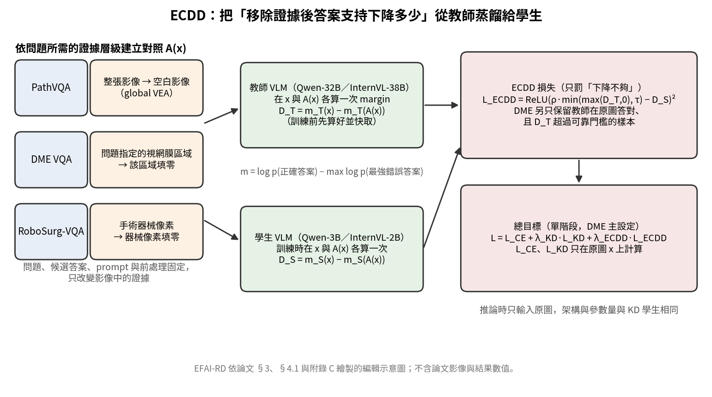

[Home](../) · [AI Papers](./)

# 答對了，但有沒有看圖？ECDD 把「遮掉證據後信心掉多少」蒸餾給 3B 醫療 VLM：DME 病灶區域的特異反應從 0.79 升到 2.02，準確率幾乎不變

## 來源

- 團隊：The University of Texas Health Science Center at Houston、Yale University、University of Michigan、University of Alabama at Birmingham、Northeastern University 與 ETH Zurich；作者為 Qizhen Lan、Yiling Ma（兩人同等貢獻）、Ruiqi Chen、Mengchen Fan、Xi Xiao、Lin Zhao、Liang He、Baocheng Geng、Pulin Che、Tianyang Wang 與 Xiaoqian Jiang（通訊作者）。[(ref: main p.1)](https://arxiv.org/pdf/2610.23469v1#page=1)
- 論文：*When Evidence Vanishes: Distilling Visual-Evidence Dependency in Medical Vision-Language Models*，arXiv v1，2026-10-16，主分類 cs.CV。[(ref: abstract)](https://arxiv.org/abs/2610.23469)
- 識別碼：[arXiv:2610.23469](https://arxiv.org/abs/2610.23469)；[DOI: 10.48550/arXiv.2610.23469](https://doi.org/10.48550/arXiv.2610.23469)。
- 全文：[arXiv PDF v1](https://arxiv.org/pdf/2610.23469v1)。本文的頁碼與表號以 v1 PDF 為準。
- 研究性質：完整方法論文（非 pilot），核心方法已實作，並在三個公開醫療 VQA 資料集上與六個訓練基線比較；屬預印本，未經同儕審查。論文未提供程式碼或權重連結。

**編輯：** Clare

ECDD（Evidence-Conditioned Dependency Distillation）不只讓小型醫療視覺語言模型（vision-language model, VLM）學會教師在原圖上偏好的答案，還要求它學會「把問題需要的視覺證據拿掉之後，對正確答案的支持應該掉多少」。[(ref: main §1)](https://arxiv.org/pdf/2610.23469v1#page=1)

## 流程

圖：EFAI-RD 依論文 §3、§4.1 與附錄 C 繪製的編輯示意圖，不含論文影像與結果數值。左欄三列對應三個資料集各自的證據對照：PathVQA 把整張影像換成空白影像，DME VQA 把問題指定的視網膜區域填零，RoboSurg-VQA 把手術器械像素填零。中欄上方是教師模型（Qwen-32B／InternVL-38B）在原圖 x 與對照 A(x) 上的 margin 差 D_T，下方是學生模型（Qwen-3B／InternVL-2B）的對應差 D_S；右欄上方是只懲罰「下降不夠」的 ECDD 損失，下方是與交叉熵和一般 KD 相加的總目標。[(ref: main §3)](https://arxiv.org/pdf/2610.23469v1#page=3) [(ref: main Fig. 2)](https://arxiv.org/pdf/2610.23469v1#page=4) [(ref: main Appendix C)](https://arxiv.org/pdf/2610.23469v1#page=12)

## 背景／問題

在本地運算、延遲、隱私或硬體受限時，醫療視覺問答（visual question answering, VQA）常需要小模型，知識蒸餾（knowledge distillation, KD）是把大模型能力搬過去的自然做法。作者的出發點是：一般 KD 只在原圖上比對教師與學生的答案分布，不檢查學生的答案是否真的取決於問題所需的影像證據。[(ref: main §1)](https://arxiv.org/pdf/2610.23469v1#page=1)

「VQA 模型會靠題目文字與語言先驗答對」這個前提，作者引用一般領域 VQA 文獻支持，也在自己的資料上量到：在 PathVQA 是非題上，一個完全不看影像、只讀題目的 Qwen-3B 模型，測試準確率達 85.48%。[(ref: main §1)](https://arxiv.org/pdf/2610.23469v1#page=1) [(ref: main §4.3)](https://arxiv.org/pdf/2610.23469v1#page=8) 不過這個數字只說明 PathVQA 是非題有很強的題目先驗，不能直接推到其他醫療 VQA 資料集。

作者把要補的東西稱為 medical visual evidence dependency：問題需要的視覺證據被移除時，模型對正確答案的支持應該下降。並指出兩個缺口：只在原圖上監督的損失無法約束學生在「證據被移除」那一端的反應（G1），而醫療證據有時是整張影像、有時是一個病灶區域、有時是一個器械，對照必須對應問題所需的層級（G2）。[(ref: main §1)](https://arxiv.org/pdf/2610.23469v1#page=2)

## 方法摘要

ECDD 為每張訓練影像配一張「證據層級對應」的對照影像 A(x)：題目、候選答案、prompt、解析度與前處理都不變，只拿掉問題需要的視覺證據。[(ref: main §3.2)](https://arxiv.org/pdf/2610.23469v1#page=3)

教師與學生都用同一種固定候選答案的打分方式：讀第一個答案位置上各選項字母的 logit，在候選集合內 softmax，取 log 機率。每一端的 margin 是「正確答案的分數 − 最強錯誤答案的分數」，dependency 則是原圖 margin 減去對照圖 margin。教師的 dependency 在訓練前先算好並快取。[(ref: main §3.1)](https://arxiv.org/pdf/2610.23469v1#page=3) [(ref: main §3.3)](https://arxiv.org/pdf/2610.23469v1#page=4) [(ref: main §3.6)](https://arxiv.org/pdf/2610.23469v1#page=5)

訓練時學生同時在原圖與對照圖上打分。ECDD 損失把教師 dependency 當成「下限」：只有學生的下降量不到教師的 ρ 倍時才懲罰，下降得比教師多則不罰；原圖上的交叉熵與一般 KD 照常保留，以維持答題準確率。推論時只輸入原圖，學生的架構與參數量和一般 KD 學生相同。[(ref: main §3.5)](https://arxiv.org/pdf/2610.23469v1#page=5) [(ref: main §5)](https://arxiv.org/pdf/2610.23469v1#page=9)

## 方法詳解

- **Margin 與 dependency** — 對模型 M、影像條件 z，margin m_M(z, q) = s_M(y⁺ | z, q) − max_{k≠y⁺} s_M(k | z, q)；dependency D_M(x, q; A) = m_M(x, q) − m_M(A(x), q)。二選一時最強錯誤答案就是另一個選項；兩端的最強錯誤答案可以不同，但候選集合固定。作者選 margin 而非 Top-1 翻轉，是因為答案不變時決策邊界仍可能移動。[(ref: main §3.3)](https://arxiv.org/pdf/2610.23469v1#page=4)
- **為什麼一般 KD 管不到** — 只在原圖上計算的任何損失（logits、機率、特徵、attention 或 margin），對學生在 A(x) 上的 margin 都沒有訓練訊號；兩個在原圖上一模一樣的學生，可以在對照圖上有完全不同的反應。[(ref: main §3.4)](https://arxiv.org/pdf/2610.23469v1#page=4)
- **Lower-bound ECDD loss** — 先取教師 dependency 的正值部分 max{D_T, 0}，再以上限 τ 截斷，得到 D̃_T⁺；L_ECDD = [ReLU(ρ·D̃_T⁺ − D_S)]²，ρ ∈ [0, 1] 控制要求學生達到教師多少比例。這個單邊設計不逼學生複製教師的每個波動。[(ref: main §3.5)](https://arxiv.org/pdf/2610.23469v1#page=5)
- **目標篩選** — 局部 presence 題只在證據標為「存在」時啟用 ECDD 項；DME 另外只保留「教師在原圖答對、且 D_T⁺ 超過可靠門檻 η = 0.5」的目標，其餘樣本只留原圖監督。[(ref: main §3.5)](https://arxiv.org/pdf/2610.23469v1#page=5) [(ref: main Appendix C.1)](https://arxiv.org/pdf/2610.23469v1#page=12)
- **總目標** — 單階段為 L = L_CE + λ_KD·L_KD + λ_ECDD·L_ECDD，其中 L_CE 與 L_KD 只在原圖上計算。Qwen-3B DME 主設定為 λ_KD = 1、λ_ECDD = 0.02、ρ = 0.5、τ = 8，學習率 10⁻⁵、bfloat16、梯度累積 8；任務梯度與 dependency 梯度內積為負時，先移除 dependency 梯度中與任務梯度平行的分量（gradient-conflict projection），這是主結果訓練配方的一部分。[(ref: main §3.6)](https://arxiv.org/pdf/2610.23469v1#page=5) [(ref: main Appendix C.1–C.2)](https://arxiv.org/pdf/2610.23469v1#page=12)
- **各設定的超參數** — DME InternVL-2B 為 λ_ECDD = 0.05、ρ = 0.7、τ = 8；RoboSurg-VQA Qwen-3B 為 0.03、0.5、4。PathVQA 用兩階段：先 SFT 一個 epoch，再以 L_CE + 0.05·L_ECDD + 0.1·L_anchor 續訓一個 epoch（ρ = 1、τ = 8，關閉 KD），L_anchor 是對凍結 SFT 模型的 KL；其他基線沒有這個額外 epoch 與 anchor 項。[(ref: main Appendix C.1)](https://arxiv.org/pdf/2610.23469v1#page=12)
- **訓練共通條件** — 所有方法都以 LoRA 微調，凍結 vision encoder，每個階段一個 epoch，並共用相同的候選字母打分介面與快取的教師輸出。[(ref: main §4.1)](https://arxiv.org/pdf/2610.23469v1#page=6) [(ref: main Appendix C.1)](https://arxiv.org/pdf/2610.23469v1#page=12)
- **論文未交代** — 程式碼、權重與完整 prompt 文字均未公開；LoRA rank／alpha、batch size、優化器，以及 DME 以外設定的學習率未列出。
- **論文未交代** — DME lesion localization（四選一區域題）只給測試題數 n = 300，未給訓練題數。
- **論文未交代** — 超參數如何選定未說明：附錄 G 敏感度掃描在 λ_ECDD = 0 時的 0.786／80.50% 與主設定 2.023 和 Table 1 測試集數值相同，論文沒有描述使用獨立驗證集選參（DME 公開切分本身含 112 張驗證影像）。
- **論文未交代** — Qwen-32B 教師在 PathVQA 與 RoboSurg-VQA 上的準確率沒有報告；Table 1–3 未標示 seed 數或變異，三個 seed 的重複只涵蓋 SFT、KD 與 ECDD。

## 資料與實驗

三個資料集分別代表三種證據層級；訓練時用的對照與只在評估時使用的對照分開。[(ref: main Appendix A)](https://arxiv.org/pdf/2610.23469v1#page=11) [(ref: main Table A1)](https://arxiv.org/pdf/2610.23469v1#page=11)

| 資料集 | 證據層級 | 任務 | 訓練／測試 | 訓練用對照 | 評估用對照 |
|---|---|---|---:|---|---|
| PathVQA（官方切分） | 整張影像 | 病理影像是非題（只保留答案恰為 yes／no 的題目） | 9,751／3,362 題 | 空白影像（global VEA） | 空白、灰、雜訊、模糊、block-shuffle、image-swap |
| DME VQA | 問題指定的視網膜區域 | 指定區域內是否有 hard exudates | 8,498／918 題（測試 381 陽性、537 陰性） | 目標區域填零 | 目標／同面積隨機遮罩、區域模糊、Telea inpainting |
| DME VQA | 問題指定的視網膜區域 | lesion localization（四選一區域題） | 未報告／300 題 | 目標區域填零 | 正確區域／非答案區域遮罩 |
| RoboSurg-VQA Q8（EndoVis2017 影格） | 手術器械像素 | 「畫面中央是否被器械遮住？」 | 1,800 題（site1 videos 1–8）／300 題（video10） | 器械像素填零 | 器械／同面積隨機遮罩 |

DME 公開切分為 433／112／134 張訓練／驗證／測試影像、9,779／2,380／1,311 組問答；RoboSurg-VQA 的 video9 因公開前處理檔不完整而排除。[(ref: main Appendix A.2–A.3)](https://arxiv.org/pdf/2610.23469v1#page=11) [(ref: main Appendix E.1)](https://arxiv.org/pdf/2610.23469v1#page=13)

主要指標：Orig Acc 是原圖 Top-1 準確率；Evid. Gap／Rand. Gap 是遮掉目標證據／同面積隨機區域後，以「原標籤」計分的準確率下降（百分點），Rand. Gap 越接近 0 越好；Specific Δm 是目標遮罩的 margin 下降減去隨機遮罩的 margin 下降，presence 題只對陽性題平均（Δm⁺）。PathVQA 的 VEA Gap 與 Δm_VEA 是原圖到空白影像的對應量，Ret. m_VEA 是對照端保留的原始 margin 比例（越低代表越少支持留存）。對照影像不被賦予新的臨床真值，只用來看答案支持是否會因證據移除而下降。[(ref: main §4.1)](https://arxiv.org/pdf/2610.23469v1#page=6) [(ref: main Appendix B)](https://arxiv.org/pdf/2610.23469v1#page=11)

下表完整重製論文 Table 1 的 lesion presence 區塊（DME，n = 918）。Teacher 與 Base 是未微調的診斷參考，不參與排名。[(ref: main Table 1)](https://arxiv.org/pdf/2610.23469v1#page=7)

| Method | Qwen-3B Orig Acc ↑ | Evid. Gap ↑ | Rand. Gap → 0 | Specific Δm ↑ | InternVL-2B Orig Acc ↑ | Evid. Gap ↑ | Rand. Gap → 0 | Specific Δm ↑ |
|---|---:|---:|---:|---:|---:|---:|---:|---:|
| Teacher | 69.39 | 3.81 | 2.18 | 3.094 | 81.26 | 16.99 | -1.85 | 4.396 |
| Base | 46.19 | 1.85 | 3.16 | 0.300 | 77.67 | 17.32 | 2.29 | 2.750 |
| SFT | 62.96 | 3.05 | -0.87 | 0.990 | 71.35 | 7.52 | -4.90 | 1.330 |
| KD | 80.50 | 3.81 | -0.11 | 0.786 | 77.78 | 12.85 | -5.45 | 1.410 |
| DBiLD | 80.28 | 4.68 | -0.11 | 1.050 | 78.87 | 14.60 | -5.12 | 1.830 |
| MedAlign | 74.62 | -0.65 | 0.65 | 0.683 | 84.86 | 23.75 | -1.09 | 2.571 |
| A3Tune | 79.19 | 2.61 | -0.76 | 0.799 | 85.62 | 24.29 | 0.00 | 2.288 |
| Beta-KD | 78.87 | 10.57 | -2.40 | 1.362 | 79.96 | 15.03 | -4.36 | 2.015 |
| ECDD | 80.39 | 16.88 | 0.87 | 2.023 | 83.77 | 24.95 | -0.87 | 3.950 |

下表完整重製論文 Table 2（RoboSurg-VQA Q8，n = 300）。Rand. Acc 是同面積隨機遮罩下的準確率。[(ref: main Table 2)](https://arxiv.org/pdf/2610.23469v1#page=7)

| Method | Orig Acc ↑ | Rand. Acc ↑ | Evid. Gap ↑ | Evid. Δm⁺ ↑ | Evid.-Rand. Δm⁺ ↑ |
|---|---:|---:|---:|---:|---:|
| Base | 68.00 | 68.67 | -2.00 | 0.328 | 0.290 |
| SFT | 61.00 | 45.67 | 27.33 | 1.210 | 0.511 |
| KD | 72.67 | 51.33 | 36.00 | 1.495 | 0.589 |
| Beta-KD | 65.33 | 46.00 | 32.00 | 1.698 | 0.704 |
| DBiLD | 68.67 | 47.00 | 35.00 | 1.660 | 0.676 |
| MedAlign | 72.00 | 53.33 | 33.00 | 1.788 | 0.685 |
| A3Tune | 73.00 | 50.67 | 34.67 | 1.189 | 0.547 |
| ECDD | 73.00 | 50.00 | 39.33 | 1.811 | 0.738 |

下表完整重製論文 Table 3（PathVQA closed yes/no，n = 3,362）。VEA Acc 以原標籤計分；ECE 與 Brier 在原圖上計算。ECDD 列使用上述兩階段配方。[(ref: main Table 3)](https://arxiv.org/pdf/2610.23469v1#page=7)

| Method | Orig Acc ↑ | VEA Acc ↓ | VEA Gap ↑ | Δm_VEA ↑ | Ret. m_VEA ↓ | ECE / Brier ↓ |
|---|---:|---:|---:|---:|---:|---|
| Base | 62.17 | 56.72 | 5.44 | 0.120 | 0.694 | 8.78 / 47.06 |
| SFT | 88.55 | 82.27 | 6.28 | 0.751 | 0.727 | 2.14 / 17.07 |
| KD | 86.79 | 81.17 | 5.62 | 0.408 | 0.694 | 8.84 / 21.34 |
| Beta-KD | 86.91 | 81.95 | 4.97 | 0.604 | 0.699 | 2.10 / 19.37 |
| MedAlign | 84.62 | 79.30 | 5.32 | 0.439 | 0.663 | 7.28 / 23.65 |
| DBiLD | 84.00 | 78.67 | 5.32 | 0.450 | 0.661 | 6.53 / 24.28 |
| A3Tune | 85.22 | 80.37 | 4.85 | 0.457 | 0.692 | 5.32 / 22.25 |
| ECDD | 89.35 | 69.10 | 20.26 | 3.863 | 0.158 | 1.38 / 15.19 |

下表完整重製論文 Table 5 的 DME 消融（Qwen-3B presence）。所有列使用相同的 CE + KD 任務目標、優化規則與訓練預算，只改變 dependency 目標或對照端。[(ref: main Table 5)](https://arxiv.org/pdf/2610.23469v1#page=8)

| Variant | Orig. ↑ | ROI Gap ↑ | Rand. Gap → 0 | ROI–Rand. Δm⁺ ↑ |
|---|---:|---:|---:|---:|
| Matched KD | 80.50 | 3.81 | -0.11 | 0.786 |
| Constant lower bound | 80.39 | 7.52 | -0.54 | 0.971 |
| Two-sided matching | 80.17 | 15.47 | 0.54 | 1.755 |
| Random-region endpoint | 79.96 | 2.40 | -0.65 | 0.747 |
| ECDD | 80.39 | 16.88 | 0.87 | 2.023 |

下表重製論文 Table A7 的三個 seed（7／17／27）結果，數值為平均 ± 樣本標準差；dependency response 在 DME 與 RoboSurg-VQA 是目標減隨機的陽性題 margin 下降，在 PathVQA 是原圖到 VEA 的 margin 下降。[(ref: main Table A7)](https://arxiv.org/pdf/2610.23469v1#page=14)

| Dataset | Method | Orig. Acc. | Dependency response | ECDD–KD gain |
|---|---|---:|---:|---:|
| DME | SFT | 63.91 ± 1.12 | 1.176 ± 0.218 | – |
| DME | KD | 80.46 ± 0.82 | 0.740 ± 0.051 | – |
| DME | ECDD | 80.46 ± 0.91 | 1.954 ± 0.101 | 1.213 ± 0.054 |
| PathVQA | SFT | 88.65 ± 0.07 | 0.848 ± 0.122 | – |
| PathVQA | KD | 86.87 ± 0.21 | 0.444 ± 0.065 | – |
| PathVQA | ECDD | 89.81 ± 0.40 | 4.105 ± 0.297 | 3.661 ± 0.241 |
| RoboSurg-VQA | SFT | 61.44 ± 10.67 | 0.481 ± 0.026 | – |
| RoboSurg-VQA | KD | 71.44 ± 1.35 | 0.509 ± 0.082 | – |
| RoboSurg-VQA | ECDD | 71.78 ± 1.07 | 0.634 ± 0.109 | 0.125 ± 0.026 |

## 結果

- **DME lesion presence（Qwen-3B）** — 與同配方 KD 相比，ECDD 的陽性題目標減隨機 margin 反應由 0.786 升到 2.023，原圖準確率 80.50% 對 80.39%。與原圖準確率最接近的 DBiLD 成對比較（同一批 918 題、bootstrap B = 5,000）：準確率差 +0.11 個百分點（95% CI [−0.87, 1.09]，McNemar p = 1.00），ROI Gap 差 12.20（[9.59, 14.92]），ROI–Rand. Δm⁺ 差 0.97（[0.91, 1.03]）。[(ref: main §4.2)](https://arxiv.org/pdf/2610.23469v1#page=6) [(ref: main Table A2)](https://arxiv.org/pdf/2610.23469v1#page=12)
- **DME（InternVL-2B）** — ECDD 的 Evid. Gap（24.95）與 Specific Δm（3.950）最高，但原圖準確率比 A3Tune 低 1.85 個百分點。Gap 從未微調 Base 的 17.32 降到 SFT 後的 7.52，再回到 ECDD 的 24.95，作者解讀為微調削弱了預訓練模型原有的證據敏感度、ECDD 部分補回。lesion localization 上 ECDD 並未在每個指標領先（例如 Qwen-3B 的 Evid. Gap 8.67 低於 MedAlign 的 12.33）。[(ref: main §4.2)](https://arxiv.org/pdf/2610.23469v1#page=6) [(ref: main Table 1)](https://arxiv.org/pdf/2610.23469v1#page=7)
- **反應集中在目標區域** — Qwen-3B presence 在 Table A4 的端點分布中，ECDD 在原圖預測 Yes 的比例為 49.35%，遮掉目標 ROI 後降到 5.45%，同面積隨機遮罩後仍是 48.04%。換成訓練時沒見過的 Telea inpainting，ECDD 相對 KD 的特異反應增益為 +0.423（23 個影像群集的 bootstrap 95% CI [0.378, 0.467]），隨機區域反應維持在 −0.033。[(ref: main Table A4)](https://arxiv.org/pdf/2610.23469v1#page=14) [(ref: main Table 6)](https://arxiv.org/pdf/2610.23469v1#page=8) [(ref: main Appendix E.4)](https://arxiv.org/pdf/2610.23469v1#page=13)
- **消融** — 把教師條件化的目標換成常數下限、把單邊下限換成雙邊精確匹配、或把對照端換成隨機區域，三者的 ROI–Rand. Δm⁺ 都低於完整 ECDD（0.971、1.755、0.747 對 2.023），其中隨機區域端點幾乎沒有效果。[(ref: main Table 5)](https://arxiv.org/pdf/2610.23469v1#page=8)
- **RoboSurg-VQA** — ECDD 與 A3Tune 並列最高原圖準確率 73.00%，Evid. Gap 39.33、Evid.-Rand. Δm⁺ 0.738 為各訓練方法最高；但三個 seed 下 ECDD–KD 的增益只有 0.125 ± 0.026，且隨機遮罩本身就讓 KD 準確率從 72.67% 掉到 51.33%。[(ref: main Table 2)](https://arxiv.org/pdf/2610.23469v1#page=7) [(ref: main Table A7)](https://arxiv.org/pdf/2610.23469v1#page=14)
- **PathVQA** — 兩階段 ECDD 的原圖準確率 89.35%、VEA Gap 20.26、Δm_VEA 3.863；SFT 與五個蒸餾基線的 VEA Gap 都在 4.85–6.28 之間。在「只讀題目模型答錯」的 488 題 prior-conflict 子集上，ECDD 比 SFT、KD、DBiLD 高 4.51、3.69、6.56 個百分點（McNemar p = 0.0021、0.0505、0.0024）。作者明說這些 PathVQA 結果反映整個兩階段配方，不能只歸因於 dependency 損失。[(ref: main §4.2)](https://arxiv.org/pdf/2610.23469v1#page=8) [(ref: main Table 4)](https://arxiv.org/pdf/2610.23469v1#page=8) [(ref: main Appendix H.1)](https://arxiv.org/pdf/2610.23469v1#page=14)
- **成本** — 在同一張 H100 上，Qwen-3B DME 的訓練時間 KD 為 286 ms／例、ECDD 為 529 ms／例（1.85 倍，不含一次性的教師 trace 生成），峰值記憶體 9.91 對 12.29 GiB；推論無額外開銷。[(ref: main Appendix C.3)](https://arxiv.org/pdf/2610.23469v1#page=13)

## 限制

作者自述的限制：[(ref: main §4.6)](https://arxiv.org/pdf/2610.23469v1#page=8)

- 這些對照只在指定的介入下量測 evidence dependency，不代表臨床穩健性或因果 grounding。
- DME 的模糊與 Telea 結果支持局部介入的遷移，PathVQA 的全域對照沒有對應的遷移證據。
- 教師答對篩選能減少不可靠目標，但無法排除所有教師偏誤或介入造成的人為訊號。
- RoboSurg-VQA 的增益較小，而且隨機遮罩本身就大幅影響準確率；ECDD 也沒有在每個 localization 指標領先。
- PathVQA 的兩階段配方多了一個 epoch 與 reference KL，其準確率與校準改善不能只歸因於 dependency 損失。
- 比較中沒有「把一般 KD 同時套在原圖與證據移除圖上」的基線，因此目前的消融只支持 ECDD 內部的設計選擇。

本書庫另外注意到的限制：

- 局部 ECDD 需要問題對應的區域或器械標註才能產生對照影像，論文沒有估計在新部署情境收集這類標註的成本（作者在附錄 A.4 也指出這一點）。[(ref: main Appendix A.4)](https://arxiv.org/pdf/2610.23469v1#page=11)
- 對照影像以原標籤計分，DME 空白影像下三個模型都對 918 題全數回答「No」，58.50% 的準確率等於陰性題比例（537／918）。因此「遮掉證據 → 回答 No」在 presence 題上與「正確答案就是 No」高度重疊，Evid. Gap 不能單獨當成讀圖能力的證據；論文以同面積隨機遮罩與 held-out 的模糊、Telea 對照處理了「只是對黑塊反應」的疑慮，但只在 DME 上驗證。[(ref: main Appendix E.1)](https://arxiv.org/pdf/2610.23469v1#page=13)
- 所有評估都是公開資料集上的封閉式選擇題，答案只讀第一個位置的選項字母 logit；自由文字作答、報告生成與臨床流程都不在範圍內。
- 超參數選擇與測試集的關係、缺漏的訓練細節與程式碼，見上方「論文未交代」。

## 與書庫其他文章的關係

ModaLens 在推論端交換影像、量測醫療 VLM 有報告可讀時是否仍對影像敏感；ECDD 則把「移除證據後答案支持該下降多少」變成蒸餾的訓練目標，並以同面積隨機遮罩確認反應集中在問題指定的區域: [ModaLens：有報告可讀時，醫療 VLM 還會看影像嗎？](2026-09-17-modalens-image-sensitivity.md)

CARE-MVLM 以移除病灶的反事實視圖訓練乳房攝影 VLM 改為棄答並給出證據框，ECDD 則不改答案標籤、只要求學生在證據被移除時對正確答案的 margin 至少下降到教師的一定比例，兩者都以無關區域的同等編輯作對照: [把病灶從乳房攝影上抹掉，VLM 會改口說「無法判斷」嗎？CARE-MVLM 用反事實三聯組訓練棄答與證據框](2026-10-07-care-mvlm-mammography-counterfactual-abstention.md)

## 實務的啟發

- **評估小模型時，加一組證據移除對照** — 本篇最容易借用的是量測方法：同一題同一組候選答案，比較原圖、遮掉目標證據、遮掉同面積隨機區域三端的 margin。Table 1 顯示原圖準確率相同的模型（KD 80.50% 與 ECDD 80.39%），對目標證據的反應可以差到兩倍以上；只報原圖準確率看不出這個差別。
- **對照的設計決定結論能說到哪裡** — 「遮掉 → 回答 No」在 presence 題上本來就和陰性答案重疊，所以要同時報隨機區域對照、訓練時沒見過的移除方式（模糊、inpainting），以及預測分布（Table A4 那種 Yes 比例）。少了這些，「學會看證據」與「學會對遮罩反應」分不開。
- **把它當成可試的訓練正則，不是已證實的部署配方** — 本篇的證據來自三個公開 VQA 資料集、未附變異的主表與只涵蓋三種方法的三個 seed 重複，沒有外部資料、自由文字輸出或臨床流程驗證；PathVQA 的大幅改善還混入了額外訓練階段。院內若要用小型醫療 VLM，ECDD 值得放進候選訓練方式，但效益需要在自家資料、自家對照設計上重新驗證。
- **標註成本要先算** — 局部 ECDD 需要區域或器械遮罩；若院內資料沒有這類標註，只能用全域的空白影像對照，而這正是本篇沒有遷移證據的設定。

## References

- `main`：[arXiv:2610.23469 摘要頁](https://arxiv.org/abs/2610.23469)；全文 [PDF v1](https://arxiv.org/pdf/2610.23469v1)。本文使用 [§1](https://arxiv.org/pdf/2610.23469v1#page=1)、[§3.1](https://arxiv.org/pdf/2610.23469v1#page=3)、[Fig. 2／§3.2–3.4](https://arxiv.org/pdf/2610.23469v1#page=4)、[§3.5–3.6](https://arxiv.org/pdf/2610.23469v1#page=5)、[§4.1](https://arxiv.org/pdf/2610.23469v1#page=6)、[Table 1–3](https://arxiv.org/pdf/2610.23469v1#page=7)、[Table 4–6／§4.6](https://arxiv.org/pdf/2610.23469v1#page=8)、[§5](https://arxiv.org/pdf/2610.23469v1#page=9)、[Appendix A–B／Table A1](https://arxiv.org/pdf/2610.23469v1#page=11)、[Table A2／Appendix C.1](https://arxiv.org/pdf/2610.23469v1#page=12)、[Appendix C.3／E](https://arxiv.org/pdf/2610.23469v1#page=13) 與 [Table A4／Table A7／Appendix G–H](https://arxiv.org/pdf/2610.23469v1#page=14)。
- `abstract`：[arXiv:2610.23469](https://arxiv.org/abs/2610.23469)。
- `doi`：[10.48550/arXiv.2610.23469](https://doi.org/10.48550/arXiv.2610.23469)。

[Home](../) · [AI Papers](./)
