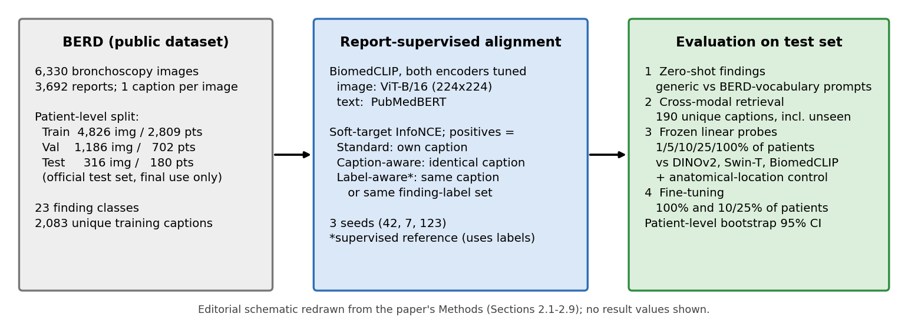

[Home](../) · [AI Papers](./)

# 支氣管鏡報告的一句描述能當監督嗎？用 BERD 影像描述微調 BiomedCLIP：零樣本 macro AUPRC 從 0.184 升到 0.255–0.292，5% 病人標籤的線性探測就高過全標籤的 DINOv2 與 Swin-T

## 來源

- 團隊：Gaziantep University 電腦工程系（土耳其）；單一作者 İlkay Sibel Kervancı。[(ref: main 首頁)](https://www.preprints.org/manuscript/202610.2687/v1/download)
- 論文：*Report-Supervised Vision–Language Alignment for Label-Efficient Bronchoscopic Finding Recognition*，Preprints.org v1 預印本（未經同儕審查），2026 年 10 月 24 日投稿、10 月 27 日張貼，CC BY 4.0。[(ref: landing)](https://www.preprints.org/manuscript/202610.2687/v1)
- 識別碼：[DOI: 10.20944/preprints202610.2687.v1](https://doi.org/10.20944/preprints202610.2687.v1)。
- 全文：[Preprints.org PDF v1](https://www.preprints.org/manuscript/202610.2687/v1/download)；程式碼：[github.com/SibelKervanci/BERD-vision-language-bronchoscopy](https://github.com/SibelKervanci/BERD-vision-language-bronchoscopy)（論文所述，含 leakage audit 與子集分派）；資料：[BERD，Science Data Bank](https://doi.org/10.57760/sciencedb.28018)。[(ref: main Data Availability)](https://www.preprints.org/manuscript/202610.2687/v1/download)
- 研究性質：完整方法研究，核心方法已實作；在公開資料集 BERD 的官方測試集（316 張影像、180 位病人）上評估，三個訓練 seed，主要比較附病人層級 bootstrap 95% CI；單一資料集、無外部資料、無讀者研究。[(ref: main §2.8–2.9, §4.5)](https://www.preprints.org/manuscript/202610.2687/v1/download)
- 證據邊界：本文依 PDF v1 正文（§1–5、Table 1–6、Figure 1–5）撰寫，ref 以章節與表號標示；補充資料（含 Supplementary Table S1 的完整 prompt 清單）未納入本文引述；流程圖為本書庫依論文方法節重繪，未轉載論文圖片。

**編輯：** Clare

這篇預印本把公開支氣管鏡資料集 BERD 裡每張影像附帶的報告描述當成唯一的訓練訊號，用標準對比學習微調 BiomedCLIP，結果零樣本辨識 23 種發現的 macro AUPRC 從 0.184 升到 0.255–0.292、凍結特徵在只有 5% 病人標籤時就高於用全部標籤的 DINOv2 與 Swin-T；但專為重複描述設計的 caption-aware 目標沒有帶來增益，完整微調也沒有提高 macro F1。[(ref: main Abstract)](https://www.preprints.org/manuscript/202610.2687/v1/download) [(ref: main §3.2–3.6)](https://www.preprints.org/manuscript/202610.2687/v1/download)

## 流程

圖：本書庫依論文 §2.1–2.9 與 Figure 1 重繪的編輯示意圖，不含成效數值。三個圓角框由左到右排列，以兩條黑色實線箭頭相連。左側灰框是 BERD：6,330 張支氣管鏡影像、3,692 份報告，病人層級切分為訓練 4,826 張／2,809 位病人、驗證 1,186 張／702 位、官方測試 316 張／180 位，23 種發現、2,083 種不重複的訓練描述。中間藍框是 report-supervised alignment：BiomedCLIP 的 ViT-B/16 影像編碼器與 PubMedBERT 文字編碼器都參與訓練，以 soft-target InfoNCE 搭配三種正例定義（Standard、Caption-aware、以星號標示為監督式參考的 Label-aware），三個 seed（42、7、123）。右側綠框列出四項測試集評估：零樣本發現辨識、跨模態檢索、凍結線性探測（含解剖位置對照）與微調，以及病人層級 bootstrap 95% CI。[(ref: main Figure 1, §2.1–2.9)](https://www.preprints.org/manuscript/202610.2687/v1/download)

## 背景／問題

作者引用的系統性回顧指出，支氣管鏡 AI 研究多數只做二元或單一標籤任務；多標籤辨識需要逐張影像的發現標註，成本高。[(ref: main §1)](https://www.preprints.org/manuscript/202610.2687/v1/download)

論文的出發點是：臨床上每張支氣管鏡影像本來就附有檢查報告的文字描述，若能直接拿來做圖文對比學習，就不必另外標註。作者另提出兩個前提，並以本篇實驗檢驗：一是 BiomedCLIP 這類以文獻圖片訓練的生物醫學模型，對支氣管鏡這種在文獻中少見的影像可能遷移不佳；二是內視鏡報告短、模板化、重複多，同一批次裡相同的描述會在標準對比學習中被當成負例（false negative），可能需要修正。[(ref: main §1)](https://www.preprints.org/manuscript/202610.2687/v1/download)

本篇只用離線指標評估辨識、檢索與標籤效率；「報告監督能改善臨床判讀或減少漏診」不在評估範圍內。

## 方法摘要

起點是 BiomedCLIP（ViT-B/16 影像編碼器、PubMedBERT 文字編碼器），用 BERD 訓練集 4,826 組「影像－報告描述」配對對兩個編碼器一起做對比學習。三種訓練目標共用同一個 symmetric soft-target InfoNCE 損失，只差在目標矩陣如何定義正例：Standard 只把自己的描述當正例；Caption-aware 把正規化後完全相同的描述都當正例，不用任何發現標籤；Label-aware 再把發現標籤集合相同的配對也當正例，作為使用標籤的監督式參考。[(ref: main §2.3)](https://www.preprints.org/manuscript/202610.2687/v1/download)

對齊後的編碼器在官方測試集上接受四項評估：以文字 prompt 做 23 種發現的零樣本辨識、圖文雙向檢索、凍結特徵加邏輯迴歸的線性探測（1% 至 100% 病人標籤），以及完整微調；線性探測另以解剖位置預測作為對照任務。[(ref: main §2.4–2.7)](https://www.preprints.org/manuscript/202610.2687/v1/download)

## 方法詳解

- **資料與切分** — BERD 共 6,330 張影像、3,692 份報告，每張影像有一句報告描述、位置標籤、發現標籤與病人 ID。發現標籤先由在地部署的 LLM 從描述提出，再經支氣管鏡醫師審查、資深專家確認。diverticulum 只有 2 張訓練影像而排除，剩 23 類；官方訓練集以 seed 42 按病人 80/20 切成訓練與驗證，官方測試集只用於最終評估，沒有病人跨子集出現。[(ref: main §2.1, Table 1)](https://www.preprints.org/manuscript/202610.2687/v1/download) [(ref: main §3.1)](https://www.preprints.org/manuscript/202610.2687/v1/download)
- **描述的重複程度** — 描述經小寫、去標點與壓縮空白正規化；訓練描述平均 8.3 個字（95 百分位 21、最長 46），4,826 張影像只有 2,083 種不重複描述。出現至少 20 次的「frequent captions」涵蓋 33.0% 的訓練影像，其中「it is normal」單獨描述 840 張。[(ref: main §2.2, Table 1)](https://www.preprints.org/manuscript/202610.2687/v1/download)
- **訓練設定** — 輸入 224 × 224、文字長度上限 128 token；AdamW，兩個編碼器學習率都是 1 × 10⁻⁵、weight decay 0.05，cosine 排程加一個 epoch 的 warm-up；batch size 64、最多 30 epoch，驗證集 R-sum 連續 5 個 epoch 沒有進步就提前停止；logit scale 上限 100、梯度裁剪 1.0、混合精度；影像增強包含縮放後隨機裁切、翻轉、旋轉、色彩抖動、autocontrast 與 Gaussian blur。checkpoint 以驗證集 R-sum 選擇，只用描述、不用標籤。[(ref: main §2.3, Figure 1)](https://www.preprints.org/manuscript/202610.2687/v1/download)
- **零樣本辨識** — 每類分數是影像 embedding 與該類 prompt embedding 平均（再正規化）的 cosine similarity。兩套 prompt：generic 為三個支氣管鏡模板加每類兩個教科書用語；BERD-vocabulary 為每類 1–3 個取自訓練描述詞彙、符合 BERD 報告風格的片語（例如 normal 用「it is normal」）。兩套 prompt 都在測試前固定。F1 的逐類門檻取自驗證集分位數，原樣套用到測試集。[(ref: main §2.4)](https://www.preprints.org/manuscript/202610.2687/v1/download)
- **跨模態檢索** — 相同描述合併後，測試集共有 190 種不重複描述作為 gallery；影像查文字以自己的描述進入前 K 名算命中，文字查影像以任一張帶該描述的影像進入前 K 名算命中。R-sum 是兩個方向 R@1、R@5、R@10 的總和，上限為 6；另分別報告排除 frequent captions 的查詢，以及訓練中從未出現的描述。[(ref: main §2.5)](https://www.preprints.org/manuscript/202610.2687/v1/download)
- **線性探測與位置對照** — 比較六個凍結編碼器：預訓練 BiomedCLIP、三個對齊後的 BiomedCLIP、DINOv2 ViT-B/14（只用 CLS，以及 CLS 加平均 patch token）與 ImageNet 預訓練的 Swin-T。特徵 L2 正規化後，每類以 class-balanced 邏輯迴歸訓練，C 由驗證集 macro AUPRC 從 {0.01, 0.1, 1, 10} 選出；1%、5%、10%、25% 的病人子集各抽 5 次，所有編碼器共用同一組子集。位置對照取訓練影像至少 20 張的 24 個位置（測試 246 張）；訓練描述中只有 0.2% 提到位置。[(ref: main §2.6)](https://www.preprints.org/manuscript/202610.2687/v1/download)
- **微調** — 分類頭為 LayerNorm、dropout 0.4、512 維 GELU 線性層、dropout 0.2 與輸出層；class-weighted BCE（正例權重上限 50）、weighted sampler、MixUp（α 0.4、p 0.3）；分類頭與編碼器學習率分別為 1 × 10⁻⁴ 與 1 × 10⁻⁵，batch size 32、最多 70 epoch。[(ref: main §2.7)](https://www.preprints.org/manuscript/202610.2687/v1/download)
- **統計與重複** — 三個 seed 各自重新對齊，監督式模型從同一 seed 的對齊 checkpoint 出發，病人切分固定；不確定性以 180 位測試病人的 cluster bootstrap（2,000 次，百分位 95% CI）估計。三個預先指定的監督式比較以 Holm 校正，只在 seed 42 內進行；線性探測的配對比較用雙尾 Wilcoxon signed-rank test。論文依 CLAIM 2024 清單報告。[(ref: main §2.8–2.9)](https://www.preprints.org/manuscript/202610.2687/v1/download)
- **資料完整性** — 以 MD5 找完全重複、以 64-bit difference hash 加像素相關係數找近似重複；敏感度分析排除所有被標記的測試影像重算，另以固定 C = 1、門檻 0.5 重跑線性探測，完全不用驗證標籤。實作在單張 RTX 4080（16 GB）上，對齊每 epoch 約 41 秒。[(ref: main §2.10–2.11)](https://www.preprints.org/manuscript/202610.2687/v1/download)
- **論文未交代** — 正文沒有列出 23 種發現的完整名稱與兩套 prompt 的完整內容（指向補充資料 Table S1）；沒有說明可學習 temperature 的初始值；沒有寫出用來提出發現標籤的 LLM 名稱，也沒有說明參與審查的支氣管鏡醫師人數；BERD 的收案年份與參與中心數未在本文交代。

## 資料與實驗

下表重製論文 Table 1：病人層級切分後的三個子集；frequent captions 指在訓練集出現至少 20 次的正規化描述。[(ref: main Table 1, §2.1–2.2)](https://www.preprints.org/manuscript/202610.2687/v1/download)

| Subset | Images | Patients | Unique Captions | Images with Frequent Captions |
|---|---|---|---|---|
| Training | 4826 | 2809 | 2083 | 1592 (33.0%) |
| Validation | 1186 | 702 | 611 | 348 (29.3%) |
| Test | 316 | 180 | 190 | 94 (29.7%) |

測試集中 mass 與 widened 沒有正例，因此所有 macro 指標以 21 個可評估類別計算；有幾類發現的測試正例少於 5 張，作者只做描述性解讀。測試集 316 張影像中有 175 張（55.4%）的描述在訓練集出現過，涵蓋 190 種測試描述中的 73 種；其餘 117 種描述（141 張影像）在對齊時從未見過。[(ref: main §2.9, §3.1, §4.5)](https://www.preprints.org/manuscript/202610.2687/v1/download)

下表重製論文 Table 2：零樣本發現辨識（21 類 macro），對齊模型為三個 seed 的平均 ± SD；Label-aware 使用發現標籤，是監督式參考。[(ref: main Table 2, §3.2)](https://www.preprints.org/manuscript/202610.2687/v1/download)

| Encoder | Prompts | AUPRC | AUC-ROC | F1 | MCC |
|---|---|---|---|---|---|
| BiomedCLIP (pretrained) | Generic | 0.184 | 0.591 | 0.223 | 0.120 |
| BiomedCLIP (pretrained) | BERD vocab. | 0.148 | 0.601 | 0.163 | 0.053 |
| Standard | Generic | 0.258 ± 0.016 | 0.781 ± 0.006 | 0.262 ± 0.013 | 0.197 ± 0.016 |
| Standard | BERD vocab. | 0.278 ± 0.009 | 0.777 ± 0.003 | 0.267 ± 0.011 | 0.205 ± 0.014 |
| Caption-aware | Generic | 0.255 ± 0.014 | 0.779 ± 0.008 | 0.263 ± 0.015 | 0.198 ± 0.015 |
| Caption-aware | BERD vocab. | 0.277 ± 0.008 | 0.775 ± 0.004 | 0.271 ± 0.004 | 0.208 ± 0.007 |
| Label-aware | Generic | 0.259 ± 0.017 | 0.786 ± 0.012 | 0.266 ± 0.012 | 0.201 ± 0.014 |
| Label-aware | BERD vocab. | 0.292 ± 0.006 | 0.803 ± 0.009 | 0.276 ± 0.006 | 0.209 ± 0.004 |

下表重製論文 Table 3：測試集跨模態檢索（gallery 為 190 種不重複描述），對齊模型為平均 ± SD；I→T 為影像查文字、T→I 為文字查影像。[(ref: main Table 3, §3.3)](https://www.preprints.org/manuscript/202610.2687/v1/download)

| Query set | Encoder | R-sum | I→T R@5 | T→I R@5 | I→T median rank |
|---|---|---|---|---|---|
| All | Pretrained | 0.303 | 0.038 | 0.058 | 85.5 |
| All | Standard | 1.614 ± 0.023 | 0.323 ± 0.003 | 0.242 ± 0.024 | 12.3 ± 0.6 |
| All | Caption-aware | 1.623 ± 0.007 | 0.329 ± 0.011 | 0.244 ± 0.013 | 12.3 ± 0.6 |
| All | Label-aware | 1.568 ± 0.040 | 0.328 ± 0.024 | 0.225 ± 0.003 | 12.2 ± 0.3 |
| Unseen captions | Pretrained | 0.321 | 0.043 | 0.051 | 70.0 |
| Unseen captions | Standard | 1.296 ± 0.037 | 0.213 ± 0.025 | 0.231 ± 0.037 | 16.7 ± 0.6 |
| Unseen captions | Caption-aware | 1.293 ± 0.007 | 0.213 ± 0.014 | 0.228 ± 0.026 | 16.0 ± 0.0 |
| Unseen captions | Label-aware | 1.277 ± 0.069 | 0.229 ± 0.039 | 0.222 ± 0.009 | 17.3 ± 1.5 |

下表重製論文 Table 4：線性探測的 macro AUPRC 隨標註病人比例的變化；對齊模型為 3 seeds 的平均 ± SD，其餘參考模型為 5 個子集的平均 ± SD（100% 只有一次）。[(ref: main Table 4, §3.4)](https://www.preprints.org/manuscript/202610.2687/v1/download)

| Encoder | 1% | 5% | 10% | 25% | 100% |
|---|---|---|---|---|---|
| BiomedCLIP (pretrained) | 0.171 ± 0.021 | 0.224 ± 0.011 | 0.237 ± 0.007 | 0.256 ± 0.015 | 0.302 |
| BERD-CLIP, standard | 0.220 ± 0.003 | 0.297 ± 0.003 | 0.311 ± 0.004 | 0.321 ± 0.004 | 0.345 ± 0.009 |
| BERD-CLIP, caption-aware | 0.221 ± 0.002 | 0.297 ± 0.005 | 0.312 ± 0.005 | 0.321 ± 0.005 | 0.343 ± 0.008 |
| BERD-CLIP, label-aware | 0.235 ± 0.008 | 0.305 ± 0.007 | 0.317 ± 0.005 | 0.331 ± 0.006 | 0.337 ± 0.002 |
| DINOv2 (CLS) | 0.145 ± 0.007 | 0.223 ± 0.009 | 0.249 ± 0.011 | 0.258 ± 0.011 | 0.287 |
| DINOv2 (CLS + patch) | 0.147 ± 0.007 | 0.228 ± 0.011 | 0.249 ± 0.017 | 0.258 ± 0.010 | 0.290 |
| Swin-T (ImageNet) | 0.146 ± 0.011 | 0.197 ± 0.010 | 0.220 ± 0.011 | 0.257 ± 0.011 | 0.275 |

下表重製論文 Table 6：以全部訓練病人做完整微調的測試結果（3 seeds 平均 ± SD）；Brier 越低越好。[(ref: main Table 6, §3.6)](https://www.preprints.org/manuscript/202610.2687/v1/download)

| Initialisation | Macro F1 | Macro AUPRC | Exact match | Brier |
|---|---|---|---|---|
| Pretrained | 0.309 ± 0.018 | 0.321 ± 0.016 | 0.152 ± 0.011 | 0.080 ± 0.003 |
| Standard | 0.309 ± 0.007 | 0.338 ± 0.007 | 0.205 ± 0.021 | 0.075 ± 0.006 |
| Caption-aware | 0.324 ± 0.014 | 0.348 ± 0.008 | 0.209 ± 0.028 | 0.072 ± 0.002 |
| Label-aware | 0.318 ± 0.009 | 0.337 ± 0.003 | 0.205 ± 0.013 | 0.075 ± 0.002 |

## 結果

- **只用報告描述對齊，零樣本辨識大幅提高** — 預訓練 BiomedCLIP 的零樣本 macro AUPRC 為 0.184（generic prompt）、AUC-ROC 0.591；對齊後 AUPRC 為 0.255–0.259（generic）與 0.277–0.292（BERD vocabulary），AUC-ROC 0.775–0.803。三種目標 × 三個 seed × 兩套 prompt 共 18 組比較，相對預訓練模型的增益全部顯著。[(ref: main §3.2, Table 2)](https://www.preprints.org/manuscript/202610.2687/v1/download)
- **報告風格的 prompt 對預訓練模型有害、對對齊模型有利** — 預訓練 BiomedCLIP 改用 BERD 風格片語時 AUPRC 降 0.035（95% CI −0.075 至 0.002）；對齊模型改用 BERD 風格片語則平均升 0.020 至 0.033。兩者的交互作用在九個對齊模型都是正的（平均 +0.055 至 +0.068），其中五個的 CI 不含 0。[(ref: main §3.2)](https://www.preprints.org/manuscript/202610.2687/v1/download)
- **逐類別的增益不均** — 對齊後每個可評估類別都高於機率水準；除了 ulcer 以外，所有對齊模型在每一類都高於預訓練模型。增益最大的是 tube、clot、nodules、surgical stump 等外觀鮮明的發現，最小的是常見而瀰漫的黏膜充血、水腫類發現。[(ref: main §3.2, Figure 2)](https://www.preprints.org/manuscript/202610.2687/v1/download)
- **檢索能推廣到沒看過的描述** — 全部查詢的 R-sum 從 0.303 升到 1.568–1.623，正確描述在 190 種中的中位排名從 85.5 升到約 12；只看訓練中從未出現的描述，R-sum 仍從 0.321 升到 1.277–1.296；排除 frequent captions 查詢時為 0.312 升到 1.231–1.284。影像查影像的 mAP，對齊模型 0.439–0.447，高於預訓練 BiomedCLIP 的 0.381 與 DINOv2、Swin-T 的 0.344–0.347。[(ref: main §3.3, Table 3)](https://www.preprints.org/manuscript/202610.2687/v1/download)
- **少標籤時的優勢最明顯** — 線性探測在每個標註比例都由對齊模型領先：1%（28 位病人）時 macro AUPRC 0.220–0.235，參考模型 0.145–0.171；5% 時 0.297–0.305，已高於用全部標籤的 DINOv2 與 Swin-T（0.275–0.290）。Standard 與 caption-aware 對三個參考模型的 20 組配對比較全部勝出（平均 ΔAUPRC +0.066 至 +0.082，p < 0.001）。[(ref: main §3.4, Table 4)](https://www.preprints.org/manuscript/202610.2687/v1/download)
- **caption-aware 目標沒有用，使用標籤才有小幅增益** — Caption-aware 對 standard 的平均 ΔAUPRC 為 +0.0002，60 組配對中 32 組較好，p = 0.96；使用發現標籤的 label-aware 對另兩者平均 +0.009，60 組中 50 組較好，p < 0.001。作者的推導是：對相同描述而言，影像查文字方向的梯度在兩種目標下相同，差別只在文字查影像方向，而 64 張的隨機批次裡除了 normal 模板外相同描述本來就少。[(ref: main §3.4, §4.2)](https://www.preprints.org/manuscript/202610.2687/v1/download)
- **對齊沒有學到解剖位置** — 位置預測的線性探測準確率，DINOv2（CLS）0.630、Swin-T 0.484，BiomedCLIP 系列只有 0.362–0.415；零樣本位置預測的 balanced accuracy 0.047–0.098，接近機率水準。作者把這解讀為報告監督讓表徵往報告內容靠攏，而描述幾乎不寫位置。[(ref: main §3.5, Table 5, §4.4)](https://www.preprints.org/manuscript/202610.2687/v1/download)
- **完整微調：F1 不變，校準與 exact match 改善** — 使用全部標籤微調時，macro F1 為 0.309–0.324，三個預先指定的比較都不顯著（seed 42 的 Holm 校正後 p ≥ 0.243）；exact match 從 0.152 升到 0.205–0.209、Brier 從 0.080 降到 0.072–0.075，macro AUPRC 只有 caption-aware 的增益顯著（seed 42：+0.052，95% CI 0.010 至 0.087）。在 10% 與 25% 標籤下，對齊模型微調後的 AUPRC（0.280–0.292）反而低於同一特徵的線性探測（0.311–0.321）。[(ref: main §3.6, Table 6)](https://www.preprints.org/manuscript/202610.2687/v1/download)
- **重複影像不影響結論** — 3 張測試影像與訓練影像逐位元相同，另有 28 張被 hash 標記為近似重複（目視為相似解剖的不同影像）；排除全部 31 張後，macro AUPRC 變化 −0.009 至 +0.023，沒有任何比較的結論改變。[(ref: main §3.1, §3.7)](https://www.preprints.org/manuscript/202610.2687/v1/download)

## 限制

- **作者自述** — 只有單一資料集（BERD）、沒有外部資料；發現標籤由 LLM 從描述提出再經專家審查，監督訊號與評估標籤並非獨立；測試集只有 180 位病人，數類發現的正例少於 5 張；沒有人口學與臨床資訊，無法做次族群分析；prompt 由作者而非支氣管鏡醫師撰寫；模型選擇與門檻使用有標籤的驗證集，固定 C 的分析只涵蓋線性探測；只測一個骨幹（BiomedCLIP ViT-B/16）與 224 × 224 解析度；沒有讀者研究。[(ref: main §4.5)](https://www.preprints.org/manuscript/202610.2687/v1/download)
- **本書庫補充：絕對數值仍低** — 最好的零樣本 macro AUPRC 約 0.29、全標籤微調的 macro F1 約 0.32、exact match 約 0.21；論文的貢獻在於相對提升與標籤效率，這些數字不應讀成可直接用於逐張判讀的效能。[(ref: main Table 2, Table 6)](https://www.preprints.org/manuscript/202610.2687/v1/download)
- **本書庫補充：描述與標籤同源** — 評估用的發現標籤由同一批描述經 LLM 提出，對齊模型又直接學這些描述；零樣本與檢索的優勢有一部分可能反映「學會 BERD 的報告用語」，作者以 BERD 風格 prompt 的交互作用也呈現了這一點。換一家醫院、換一種報告寫法時的表現，本篇沒有測試。[(ref: main §2.1, §3.2)](https://www.preprints.org/manuscript/202610.2687/v1/download)
- **本書庫補充：同院同資料集內的測試** — 測試集有 55.4% 的影像其描述在訓練中出現過；雖然論文另報未見描述的檢索結果，零樣本與線性探測沒有依此拆分。[(ref: main §3.1)](https://www.preprints.org/manuscript/202610.2687/v1/download)
- **本書庫補充：Holm 校正只在單一 seed** — 微調的三個預先指定比較只在 seed 42 內做 Holm 校正，沒有跨 seed 的多重比較校正；讀者解讀個別 seed 的「顯著」時宜保守。[(ref: main §2.9, §3.6)](https://www.preprints.org/manuscript/202610.2687/v1/download)

## 與書庫其他文章的關係

兩篇都在固定資料與評估條件下檢驗圖文對比學習目標本身的影響：該研究在胸片上比較九種不同粒度的預訓練目標，本篇在支氣管鏡上比較三種正例定義，結果是只依描述合併正例的 caption-aware 目標與標準 CLIP 目標沒有差別: [胸片 VLM 的視覺編碼器該學全域還是局部？九種預訓練目標、五項任務的對照實驗](2026-09-30-cxr-vlp-granularity-controlled-study.md)

該研究顯示 BiomedCLIP 等零樣本 dual-encoder 未經任務調整時在皮膚病灶分類上落後有訓練的模型；本篇示範另一條路，不加影像標註、只用支氣管鏡報告描述對 BiomedCLIP 做領域對齊，再量零樣本與少標籤線性探測能提高多少: [皮膚病灶良惡性分類：零樣本 VLM、微調 CNN 與凍結特徵，在十個資料設定下差多少？](2026-10-05-derm-generalist-vs-specific-benchmark.md)

## 實務的啟發

這是一篇完整實作、程式碼與資料公開、主要比較附 CI 與三個 seed 的單一資料集研究。它的結論比較適合當作「院內已經有報告文字、但沒有逐張標註時，可以先試什麼」的參考，而不是可直接部署的支氣管鏡判讀器。

第一，報告文字是一個值得先試的低成本訊號。在本篇設定下，只用每張影像的一句描述做對比學習，就讓凍結特徵在 5% 病人標籤時超過用全部標籤的 DINOv2 與 Swin-T；有類似「影像附描述」資料的內視鏡團隊，可以把「先用描述對齊、再用少量標籤做線性探測」當作基線之一。這是單一資料集的結果，換院、換報告格式需要重測。[(ref: main §3.4, Table 4)](https://www.preprints.org/manuscript/202610.2687/v1/download)

第二，零樣本 prompt 要用自家報告的詞彙。對齊後，用 BERD 報告風格的片語比通用教科書用語更好，但對未對齊的預訓練模型則相反；評估或部署零樣本模型時，prompt 詞彙與訓練語料的對應關係本身就是一個需要回報的變因。[(ref: main §3.2)](https://www.preprints.org/manuscript/202610.2687/v1/download)

第三，處理重複描述的特製損失不一定值得。本篇的 caption-aware 目標在三項評估都沒有勝過標準目標，作者推測真正的問題可能在同義改寫而非完全相同的描述；在投入這類設計前，先檢查批次中實際有多少相同描述。[(ref: main §3.4, §4.2)](https://www.preprints.org/manuscript/202610.2687/v1/download)

第四，報告監督學到的是報告寫了什麼。描述幾乎不提位置，對齊後的表徵在位置預測上就輸給沒看過文字的 DINOv2；若應用需要同時定位與辨識發現，作者建議的組合報告對齊特徵與自監督特徵是一個待驗證的方向，本篇沒有實作。[(ref: main §3.5, §4.4)](https://www.preprints.org/manuscript/202610.2687/v1/download)

## References

- `main`：[Report-Supervised Vision–Language Alignment for Label-Efficient Bronchoscopic Finding Recognition，Preprints.org PDF v1](https://www.preprints.org/manuscript/202610.2687/v1/download)；本文使用 Abstract、§1 Introduction、§2.1–2.11（Figure 1、Table 1）、§3.1–3.7（Table 2–6、Figure 2）、§4.2、§4.4、§4.5 Limitations、Data Availability。
- `landing`：[Preprints.org 論文頁 v1](https://www.preprints.org/manuscript/202610.2687/v1)。
- `doi`：[10.20944/preprints202610.2687.v1](https://doi.org/10.20944/preprints202610.2687.v1)。
- `code`：[github.com/SibelKervanci/BERD-vision-language-bronchoscopy](https://github.com/SibelKervanci/BERD-vision-language-bronchoscopy)。
- `data`：[BERD，Science Data Bank，doi:10.57760/sciencedb.28018](https://doi.org/10.57760/sciencedb.28018)。

[Home](../) · [AI Papers](./)
