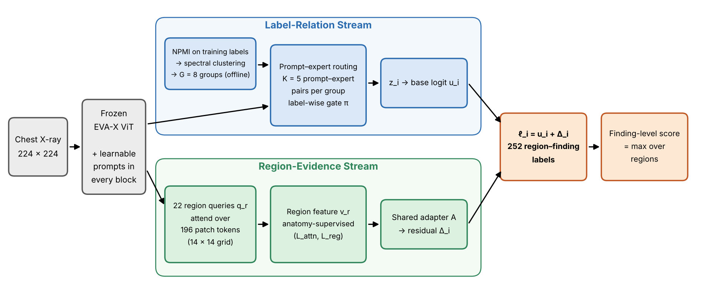

[Home](../) · [AI Papers](./)

# CoRE：把胸片標籤拆成 252 個「部位－發現」配對，以共現分組的 prompt 與區域證據調整凍結的 EVA-X，2.09M 可訓練參數下 macro AUROC 比 ML-VPT 高 0.0147

## 來源

- 團隊：Yeji X（韓國首爾）；共 2 位作者：Minjun Kim、Jong Hak Moon（通訊作者）。[(ref: main p.1)](https://arxiv.org/pdf/2610.30584v1#page=1)
- 論文：*CoRE: Relating Fine-Grained Chest X-ray Findings in Anatomical Context*，arXiv v1（eess.IV），2026 年 10 月 22 日提交。[(ref: abstract)](https://arxiv.org/abs/2610.30584)
- 識別碼：[arXiv:2610.30584](https://arxiv.org/abs/2610.30584)；[DOI: 10.48550/arXiv.2610.30584](https://doi.org/10.48550/arXiv.2610.30584)。
- 全文：[arXiv PDF v1](https://arxiv.org/pdf/2610.30584v1)；程式碼：[github.com/yejix-ai/CoRE](https://github.com/yejix-ai/CoRE)（論文所述，含前處理與訓練程式）。[(ref: main p.1)](https://arxiv.org/pdf/2610.30584v1#page=1)
- 研究性質：完整方法論文，核心方法已實作，並在 MIMIC-CXR 衍生的三組標註（CI Silver、MS-CXR、CI gold standard）與兩個外部資料集（VinDr-CXR、CheXpert）上評估；主要指標附 10,000 次病人層級配對 bootstrap 的 95% CI，分組策略另有三個訓練 seed 的平均與標準差；沒有放射科醫師讀者研究。[(ref: main §4.1, p.5)](https://arxiv.org/pdf/2610.30584v1#page=5) [(ref: main Table 9, p.15)](https://arxiv.org/pdf/2610.30584v1#page=15)
- 證據邊界：本文依 arXiv v1 PDF 正文與附錄 A–E（Table 1–14、Figure 1–3）撰寫；文中流程圖為本書庫依論文方法節重繪，未轉載論文圖片。

**編輯：** Clare

CoRE 把胸片多標籤分類的單位從「有沒有肺炎」改成「左上肺區有沒有肺炎」這類 252 個部位－發現配對，用訓練集的共現統計把配對分組來共用 prompt，再加一條由解剖框監督的區域證據分支；在 MIMIC-CXR 上，它以約 2.09M 可訓練參數，在 macro AUROC、AUPRC 與定位 pointing-game 上都高於同骨幹的 prompt tuning 基線，但絕對 AUPRC 約 0.20、macro F1 約 0.15，離逐標籤可用的決策仍有距離。[(ref: main Abstract, p.1)](https://arxiv.org/pdf/2610.30584v1#page=1) [(ref: main Table 1, p.6)](https://arxiv.org/pdf/2610.30584v1#page=6)

## 流程

圖：本書庫依論文 §3 與 Figure 1 重繪的編輯示意圖，不含成效數值。左側兩個灰框是輸入胸片與凍結的 EVA-X 骨幹（每個 block 插入可學習 prompt）。上方藍框 Label-Relation Stream 內有三個方塊：離線以 NPMI 與 spectral clustering 把訓練標籤分成 G = 8 組；每組 K = 5 個 prompt–expert 配對，由逐標籤的 gate π 加權；輸出 z_i 與 base logit u_i。下方綠框 Region-Evidence Stream 內也有三個方塊：22 個 region query 對 14 × 14 共 196 個 patch token 做 attention；區域特徵 v_r 受解剖框監督（L_attn、L_reg）；共用 adapter A 輸出 residual Δ_i。右側兩個橘框為 ℓ_i = u_i + Δ_i 的 252 個 region–finding 標籤，以及取各區域最大值的 finding 層級分數；箭頭皆為黑色實線。[(ref: main Figure 1, §3, p.3)](https://arxiv.org/pdf/2610.30584v1#page=3) [(ref: main §3.2–3.4, p.4)](https://arxiv.org/pdf/2610.30584v1#page=4) [(ref: main §4.1, p.5)](https://arxiv.org/pdf/2610.30584v1#page=5)

## 背景／問題

論文引用放射學文獻指出，胸片發現要放在解剖位置與伴隨異常中解讀：心臟擴大、肺血管重分布與肋膜積液一起出現時支持鬱血性心衰竭；上肺葉不透明影可能指向原發後結核或肉芽腫疾病，下垂部位的不透明影則可能指向吸入性肺炎。[(ref: main §1, p.1)](https://arxiv.org/pdf/2610.30584v1#page=1)

作者指出兩條既有研究線各缺一半。多標籤影像辨識中的 label-correlation 方法（例如 ML-GCN、CheXGCN）用共現統計或圖結構建模標籤關係，但關係定義在全域的 finding 標籤上，分不出同一個發現出現在不同部位；anatomy-aware 預測與 phrase grounding 方法能把發現連到區域證據，但通常不把「帶部位的發現」當成定義標籤關係的單位。[(ref: main §1–2, p.1–2)](https://arxiv.org/pdf/2610.30584v1#page=1)

論文要回答的是：如果把 region–finding 配對同時當成預測目標與共現分組的單位，再補上區域對應的視覺證據，細粒度分類與定位會不會比只做 label-relation prompt 的方法好。「這樣做能改善臨床判讀」不在本篇的評估範圍內，論文只用離線分類與 bounding-box 定位指標檢驗。

## 方法摘要

CoRE 的預測目標是 252 個 region–finding 標籤，來自 Chest ImaGenome（CI）的 28 種 finding 與 22 個解剖區域的有效組合；骨幹是凍結的 EVA-X 視覺 transformer，只訓練 prompt、gate、區域 query 與分類頭等約 2.09M 參數。[(ref: main §3, p.2)](https://arxiv.org/pdf/2610.30584v1#page=2) [(ref: main Table 1, p.6)](https://arxiv.org/pdf/2610.30584v1#page=6)

Label-Relation Stream 先離線以 normalized pointwise mutual information（NPMI）估計標籤兩兩的共現強度，用 spectral clustering 分成 G 組；每組共用 K 個 prompt–expert 配對，以 deep visual prompt tuning（VPT）插入每個 ViT block，每個標籤再用自己的 gate 混合所屬組的 expert 輸出，得到 base logit。這部分改編自 ML-VPT 的 group-wise prompt–expert routing，差別在分組單位是 region–finding 配對。[(ref: main §3.1, p.2–4)](https://arxiv.org/pdf/2610.30584v1#page=2)

Region-Evidence Stream 為每個解剖區域設一個可學習 query，對 patch 特徵做 attention 得到區域表徵，經共用 adapter 後投影到該標籤的分類方向，成為加在 base logit 上的 residual；這條分支在訓練時以解剖框監督 attention 與「該區域是否有任何發現」。[(ref: main §3.2–3.4, p.4–5)](https://arxiv.org/pdf/2610.30584v1#page=4)

## 方法詳解

- **標籤空間與解剖階層** — 沿用前作的 28 種 finding 詞彙，保留訓練集中至少 80 個正例的 finding×region 配對，得到 252 個標籤、22 個區域。某個較細區域的標籤為正時，訓練中遮蔽較粗區域的同一標籤；評估時較粗區域的分數取自身與同側同 finding 子區域分數的最大值，ground truth 也做相同的向上閉包；所有方法採同樣處理。[(ref: main Appendix A.1, p.13)](https://arxiv.org/pdf/2610.30584v1#page=13) [(ref: main §4.1, p.5)](https://arxiv.org/pdf/2610.30584v1#page=5)
- **NPMI 共現分組** — 以訓練集的經驗機率計算 PMI_ij = log p_ij / (p_i p_j)，再除以 −log p_ij 得 NPMI；affinity C_ij 只保留正的 NPMI，非正值與從未共現的配對設為 0，再以 spectral clustering 切成 G 組，每個標籤的組別固定。作者把這個 affinity 當作表徵共享的結構先驗，不當作標籤間的直接交互權重。G = 8 時 NPMI 分組的組大小為 16 至 51 個標籤，Conditional 分組為 11 至 76 個。[(ref: main Eq. 1–3, p.2–3)](https://arxiv.org/pdf/2610.30584v1#page=2) [(ref: main Appendix A.2, Table 7–8, p.13–14)](https://arxiv.org/pdf/2610.30584v1#page=13)
- **Prompt–expert routing** — 每組 K 個可學習的 prompt–expert 配對，共 G × K 個逐層 prompt 插入每個 ViT block，與 CLS 及 patch token 一起處理，不同 prompt token 之間的 attention 被遮蔽；每個 prompt 特徵經各自的 expert（殘差式兩層 GELU MLP）轉換。標籤 i 用自己的 gating 向量對所屬組的 K 個 prompt 特徵打分，softmax 後加權組合 expert 輸出得到 z_i。[(ref: main Eq. 4–6, p.3–4)](https://arxiv.org/pdf/2610.30584v1#page=3)
- **區域 attention** — 每個區域 r 的 query q_r 與 M 個 patch 特徵算縮放後的 cosine similarity（乘 √D），再各自過 sigmoid 而非 softmax，讓多個 patch 可同時對同一區域高權重；區域表徵為 LN(q_r + 加權平均 patch 特徵)。[(ref: main Eq. 7–8, p.4)](https://arxiv.org/pdf/2610.30584v1#page=4)
- **Region-matched logit residual** — 每個標籤對應到它的解剖區域；區域表徵經共用的兩層 bottleneck adapter A 後，以同一個標籤權重 w_i 投影成 residual Δ_i，最終 logit ℓ_i = u_i + Δ_i。A 的輸出投影以零初始化，訓練開始時 Δ_i = 0，不擾動 base logit。[(ref: main Eq. 9, p.4)](https://arxiv.org/pdf/2610.30584v1#page=4)
- **訓練目標** — 主損失為 asymmetric loss（ASL，γ⁺ = 0、γ⁻ = 2）；另加三項輔助：以 routing 分數組成的輔助 logit 套 ASL（L_gate），以投影後的解剖框作為二元遮罩、用 BCE 監督 attention logit（L_attn），以及區域層級「是否有任何目標發現」的 BCE（L_reg）；權重 λ_gate = 1.0、λ_attn = 0.5、λ_reg = 0.3。推論只用 ℓ_i。[(ref: main Eq. 10–12, p.4–5)](https://arxiv.org/pdf/2610.30584v1#page=4) [(ref: main §4.1, p.5)](https://arxiv.org/pdf/2610.30584v1#page=5)
- **實作設定** — 凍結的預訓練 EVA-X 骨幹，G = 8、K = 5、22 個區域 query，使用 14 × 14 網格的全部 196 個 patch token；輸入 224 × 224；AdamW、batch size 512、學習率 5 × 10⁻⁴、weight decay 10⁻²、OneCycle 排程，訓練 20 epoch。[(ref: main §4.1, p.5)](https://arxiv.org/pdf/2610.30584v1#page=5) [(ref: main Appendix B.1, p.15)](https://arxiv.org/pdf/2610.30584v1#page=15)
- **基線設定** — Linear probing（LP）與 full fine-tuning（FFT）用 ImageNet 預訓練的 ViT-B/16、RAD-DINO-MAIRA-2（表中記為 RAD-DINO-2）與 EVA-X，超參數依驗證集分別選擇；VPT-Shallow、VPT-Deep（各 40 個 prompt token）與 ML-VPT 都以 EVA-X 為凍結骨幹，與 CoRE 共用 ASL 與優化設定；定位與零樣本基線使用官方釋出的 checkpoint 與前處理。[(ref: main §4.1, p.5)](https://arxiv.org/pdf/2610.30584v1#page=5) [(ref: main Appendix B.1, p.15)](https://arxiv.org/pdf/2610.30584v1#page=15)
- **論文未交代** — 正文沒有寫明所用 EVA-X 的模型尺寸與權重版本、每個 prompt 的 token 長度、adapter A 的 bottleneck 維度；Table 1 的主要結果是否為單一訓練 seed 未說明，其 CI 來自測試集病人的 bootstrap，不涵蓋訓練隨機性（三個 seed 的結果只報告於分組比較）；F1 使用固定 0.5 門檻，沒有逐標籤調整。

## 資料與實驗

下表整理論文使用的資料與評估角色。[(ref: main §4.1, p.5)](https://arxiv.org/pdf/2610.30584v1#page=5) [(ref: main Appendix B.2, C.2, D, p.15–17)](https://arxiv.org/pdf/2610.30584v1#page=15)

| 資料 | 角色 | 規模與標註（論文所述） |
|---|---|---|
| MIMIC-CXR＋Chest ImaGenome（CI Silver） | 訓練、驗證、主要測試 | 241,451 張正面胸片、63,764 位病人；官方切分 236,089／1,959／3,403 張；252 個 region–finding 標籤，CI Silver 標籤由報告與偵測到的解剖區域自動產生 |
| MS-CXR | finding 定位（P. Hit） | phrase 層級 bounding box；1,162 筆標註中 1,160 筆在 224 × 224 中心裁切後仍有效；評估影像以影像層級排除於訓練之外 |
| CI gold standard | finding 定位、region–finding 分類 | 500 張人工驗證與修正的影像；分類時只有 83 個標籤同時有正負例 |
| VinDr-CXR（官方測試集） | 外部 finding 層級分類 | 9 個對應 finding，不做目標域調整 |
| CheXpert（官方測試集） | 外部 finding 層級分類 | 8 個對應 finding，不做目標域調整 |

主要指標為 macro AUROC 與 macro AUPRC，另報 macro F1、micro F1（固定門檻 0.5）與可訓練參數量；測試集 252 個標籤中有一個沒有正例，macro 指標以 251 個有正負例的標籤計算。定位用 pointing-game hit rate（P. Hit）：分類模型取 gradient–activation attribution 最高的 patch，中心落在該標籤的 ground-truth 框內即算命中；phrase grounding 模型則取排名第一的預測框中心。[(ref: main §4.1, p.5)](https://arxiv.org/pdf/2610.30584v1#page=5) [(ref: main Appendix C.1, p.16)](https://arxiv.org/pdf/2610.30584v1#page=16) [(ref: main Appendix D, p.17)](https://arxiv.org/pdf/2610.30584v1#page=17) [(ref: main §4.4, p.7)](https://arxiv.org/pdf/2610.30584v1#page=7)

下表重製論文 Table 1：MIMIC-CXR 測試集 252 個 region–finding 標籤的分類與 attribution，括號為 95% CI；P. Hit 以 CI 解剖標註計算。[(ref: main Table 1, p.6)](https://arxiv.org/pdf/2610.30584v1#page=6)

| Method | Backbone | Params. | AUROC | AUPRC | Macro F1 | Micro F1 | P. Hit |
|---|---|---|---|---|---|---|---|
| LP | ViT-B/16 | 0.19M | 0.6574 (.6389–.6695) | 0.0907 (.0895–.1079) | 0.0424 | 0.3961 | 0.1810 |
| LP | RAD-DINO-2 | 0.19M | 0.7730 (.7557–.7848) | 0.1430 (.1408–.1635) | 0.0690 | 0.4682 | 0.2948 |
| LP | EVA-X | 0.19M | 0.7872 (.7701–.7987) | 0.1531 (.1507–.1742) | 0.0762 | 0.4724 | 0.3768 |
| FFT | ViT-B/16 | 85.99M | 0.7526 (.7348–.7650) | 0.1313 (.1294–.1508) | 0.0548 | 0.4661 | 0.2627 |
| FFT | RAD-DINO-2 | 86.77M | 0.8035 (.7867–.8144) | 0.1624 (.1598–.1840) | 0.0778 | 0.5042 | 0.3425 |
| FFT | EVA-X | 86.04M | 0.8075 (.7906–.8180) | 0.1639 (.1612–.1857) | 0.0883 | 0.5196 | 0.3872 |
| VPT-Shallow | EVA-X | 0.22M | 0.7816 (.7640–.7951) | 0.1370 (.1352–.1571) | 0.0732 | 0.5282 | 0.3779 |
| VPT-Deep | EVA-X | 0.56M | 0.7947 (.7776–.8062) | 0.1418 (.1392–.1637) | 0.0783 | 0.5351 | 0.4047 |
| ML-VPT | EVA-X | 2.08M | 0.8283 (.8113–.8384) | 0.1831 (.1801–.2058) | 0.1398 | 0.5536 | 0.5483 |
| CoRE | EVA-X | 2.09M | 0.8430 (.8261–.8531) | 0.2024 (.1961–.2295) | 0.1546 | 0.5675 | 0.5671 |

下表合併論文 Table 2 與 Table 9：兩條分支與分組策略的消融。左側為單次結果（括號為 95% CI），右側為三個訓練 seed 的平均 ± 標準差；L-S、R-S 分別為 Label-Relation 與 Region-Evidence Stream。[(ref: main Table 2, p.6)](https://arxiv.org/pdf/2610.30584v1#page=6) [(ref: main Table 9, p.15)](https://arxiv.org/pdf/2610.30584v1#page=15)

| Configuration | L-S | R-S | AUROC | AUPRC | AUROC（3 seeds） | AUPRC（3 seeds） |
|---|---|---|---|---|---|---|
| w/o L-S | ✗ | ✓ | 0.8250 (.8081–.8351) | 0.1800 (.1722–.2048) | – | – |
| w/o R-S | ✓ | ✗ | 0.8408 (.8241–.8514) | 0.2003 (.1925–.2251) | – | – |
| Single (G = 1) | ✓ | ✓ | 0.8335 (.8167–.8438) | 0.1902 (.1840–.2175) | – | – |
| Random (G = 8) | ✓ | ✓ | 0.8423 (.8255–.8526) | 0.1993 (.1932–.2268) | 0.8426 ± 0.0033 | 0.1992 ± 0.0030 |
| Conditional (G = 8) | ✓ | ✓ | 0.8411 (.8244–.8517) | 0.1986 (.1926–.2261) | 0.8417 ± 0.0014 | 0.2002 ± 0.0027 |
| NPMI (G = 8, CoRE) | ✓ | ✓ | 0.8430 (.8261–.8531) | 0.2024 (.1961–.2295) | 0.8436 ± 0.0023 | 0.2031 ± 0.0021 |
| Finding-level NPMI | ✓ | ✓ | – | – | 0.8404 ± 0.0022 | 0.2024 ± 0.0033 |

下表重製論文 Table 3：輔助目標的消融。[(ref: main Table 3, p.7)](https://arxiv.org/pdf/2610.30584v1#page=7)

| L_gate | L_attn | L_reg | AUROC | AUPRC | P. Hit |
|---|---|---|---|---|---|
| ✗ | ✗ | ✗ | 0.8378 | 0.1917 | 0.5479 |
| ✓ | ✗ | ✗ | 0.8409 | 0.1941 | 0.5493 |
| ✓ | ✓ | ✗ | 0.8414 | 0.1943 | 0.5684 |
| ✓ | ✗ | ✓ | 0.8416 | 0.1989 | 0.5523 |
| ✗ | ✓ | ✓ | 0.8390 | 0.1946 | 0.5745 |
| ✓ | ✓ | ✓ | 0.8430 | 0.2024 | 0.5671 |

下表重製論文 Table 4：MS-CXR 與 CI gold standard 的 finding 定位，Image／Text 為各方法的輸入模態。[(ref: main Table 4, p.7)](https://arxiv.org/pdf/2610.30584v1#page=7)

| Method | Image | Text | P. Hit（MS-CXR） | P. Hit（CI） |
|---|---|---|---|---|
| ChEX | ✓ | ✓ | 0.7724 | 0.8381 |
| MedGrounder | ✓ | ✓ | 0.7603 | 0.7895 |
| ML-VPT | ✓ | ✗ | 0.7595 | 0.8702 |
| CoRE w/o R-S | ✓ | ✗ | 0.7655 | 0.8861 |
| CoRE | ✓ | ✗ | 0.7853 | 0.9045 |

下表重製論文 Table 5：finding 層級表現，CoRE 與 prompt 基線取各區域 logit 的最大值作為 finding 分數；CheXzero、RadZero、CARZero 為零樣本 CXR 基線。[(ref: main Table 5, §4.5, p.7)](https://arxiv.org/pdf/2610.30584v1#page=7)

| Method | AUROC CI（28 labels） | AUROC VinDr-CXR（9） | AUROC CheXpert（8） | AUPRC CI | AUPRC VinDr-CXR | AUPRC CheXpert |
|---|---|---|---|---|---|---|
| CheXzero | 0.6731 | 0.8444 | 0.8428 | 0.2130 | 0.3496 | 0.5465 |
| RadZero | 0.7877 | 0.8859 | 0.8968 | 0.2885 | 0.4372 | 0.5810 |
| CARZero | 0.7820 | 0.9202 | 0.9100 | 0.2948 | 0.4708 | 0.6521 |
| VPT-Deep | 0.8010 | 0.8771 | 0.8667 | 0.3098 | 0.4182 | 0.5712 |
| ML-VPT | 0.8319 | 0.9140 | 0.8983 | 0.3564 | 0.4777 | 0.6540 |
| CoRE | 0.8442 | 0.9313 | 0.9125 | 0.3748 | 0.4978 | 0.6653 |

## 結果

- **對最接近基線的增幅有 CI 支持，但幅度約 0.01–0.02** — 在幾乎相同的可訓練參數量下（2.09M 對 2.08M），CoRE 比 ML-VPT 的 AUROC 高 0.0147（95% CI 0.0083 至 0.0209）、AUPRC 高 0.0193（95% CI 0.0077 至 0.0263），皆為 10,000 次病人層級配對 bootstrap；macro F1 從 0.1398 升到 0.1546，micro F1 從 0.5536 升到 0.5675，P. Hit 從 0.5483 升到 0.5671。[(ref: main §4.2, p.5)](https://arxiv.org/pdf/2610.30584v1#page=5) [(ref: main Table 1, p.6)](https://arxiv.org/pdf/2610.30584v1#page=6)
- **少訓練 97.6% 參數，仍高於同骨幹的 full fine-tuning** — 以 EVA-X 為骨幹，CoRE 的 AUROC 0.8430、AUPRC 0.2024，高於 FFT 的 0.8075 與 0.1639；FFT 訓練 86.04M 參數。[(ref: main §4.2, p.5)](https://arxiv.org/pdf/2610.30584v1#page=5) [(ref: main Table 1, p.6)](https://arxiv.org/pdf/2610.30584v1#page=6)
- **Label-Relation Stream 貢獻較大，分組策略本身影響小** — 拿掉 Label-Relation Stream 時 AUROC 降到 0.8250，拿掉 Region-Evidence Stream 只降到 0.8408；所有 G = 8 的分組都高於單一組（0.8335），但三個 seed 下 NPMI、Conditional、Random 的平均 AUROC 為 0.8436、0.8417、0.8426，差距與標準差（0.0014 至 0.0033）同一量級，作者也說明分組準則的敏感度有限。以 region–finding 為單位計算 NPMI 的 AUROC 在三個 seed 都高於以 finding 為單位（平均 0.8404），AUPRC 則相近。[(ref: main §4.3, p.6)](https://arxiv.org/pdf/2610.30584v1#page=6) [(ref: main Appendix A.3, p.14–15)](https://arxiv.org/pdf/2610.30584v1#page=14)
- **輔助目標分工不同** — 三項輔助都拿掉時 AUROC 0.8378、P. Hit 0.5479；在拿掉單一輔助目標的比較中，拿掉 L_attn 讓 P. Hit 降得最多（0.5523）；拿掉 L_gate 的 P. Hit 反而略高（0.5745），但 AUROC 與 AUPRC 較低。[(ref: main §4.3, p.6–7)](https://arxiv.org/pdf/2610.30584v1#page=6) [(ref: main Table 3, p.7)](https://arxiv.org/pdf/2610.30584v1#page=7)
- **只看影像的定位高於使用文字 phrase 的 grounding 模型** — P. Hit 在 MS-CXR 為 0.7853、在 CI gold standard 為 0.9045，高於以 annotated phrase 為查詢的 ChEX（0.7724、0.8381）與 MedGrounder（0.7603、0.7895）；加入 Region-Evidence Stream 讓 MS-CXR 從 0.7655 升到 0.7853、CI 從 0.8861 升到 0.9045。[(ref: main §4.4, p.7)](https://arxiv.org/pdf/2610.30584v1#page=7) [(ref: main Table 4, p.7)](https://arxiv.org/pdf/2610.30584v1#page=7)
- **聚合到 finding 層級後在外部資料集仍領先比較組** — 取各區域最大 logit 作為 finding 分數，CoRE 在 CI、VinDr-CXR、CheXpert 三組的 AUROC 與 AUPRC 都是 Table 5 中最高；在附錄另一組對照中，直接以同一訓練集對 28 個 finding 做 full fine-tuning 的 EVA-X FFT-28，在 VinDr-CXR AUROC（0.9346 對 0.9313）與 CheXpert AUPRC（0.6833 對 0.6653）高於 CoRE，作者的結論是兩種監督策略各有勝負。[(ref: main §4.5, p.7–8)](https://arxiv.org/pdf/2610.30584v1#page=7) [(ref: main Table 14, Appendix C.3, p.17)](https://arxiv.org/pdf/2610.30584v1#page=17)
- **排除稀有標籤與人工標註集上方向一致** — 252 個測試標籤中有 59 個正例少於 10 個（其中 26 個少於 5 個）；只看 193 個正例至少 10 個的標籤，CoRE 對 ML-VPT 的 AUROC 差 +0.0128（95% CI 0.0083 至 0.0177）、AUPRC 差 +0.0120（95% CI 0.0020 至 0.0203）。在 CI gold standard 的 83 個可評估標籤上，CoRE 的 AUROC／AUPRC／F1@0.5 為 0.8806／0.8637／0.3904，ML-VPT 為 0.8561／0.8323／0.3507；作者提醒這組標籤集與遮罩不同，絕對值不能與 Table 1 比較。[(ref: main Appendix C.1–C.2, Table 12–13, p.16)](https://arxiv.org/pdf/2610.30584v1#page=16)
- **病人重疊的檢查** — MS-CXR 與 CI gold standard 的評估影像只以影像層級排除於訓練之外；851 位 MS-CXR 評估病人中 712 位（83.7%）、500 位 CI gold 評估病人中 335 位（67.0%）在訓練集另有檢查。只取訓練集中沒有任何檢查的病人時，CoRE 的 P. Hit（MS-CXR 0.8979、CI Gold 0.9063）與 CI Gold 分類（AUROC 0.8882）點估計仍高於 ML-VPT（0.8766、0.8580、0.8594）；此子集較小，論文未附 CI。[(ref: main Appendix B.2, p.15)](https://arxiv.org/pdf/2610.30584v1#page=15) [(ref: main Table 11, p.16)](https://arxiv.org/pdf/2610.30584v1#page=16)
- **錯誤案例** — 對 lung opacity、edema 這類範圍大的異常，saliency 只涵蓋標註範圍的一部分；肋膈角的例子中最高 saliency 落在目標框外的相鄰區域、該區域也有同一種異常，在 P. Hit 下被算成錯誤。[(ref: main Appendix E, Figure 3, p.17–18)](https://arxiv.org/pdf/2610.30584v1#page=17)

## 限制

- **作者自述** — CoRE 依賴靜態的共現統計組織標籤共享；細粒度 region–finding 的監督與驗證大多只在單一有解剖標註的資料集；空間對齊以 bounding box 準則評估，不是 dense localization。附錄也說明 CoRE 針對 region–finding 分類最佳化，沒有要求涵蓋整個病灶範圍。[(ref: main §5, p.9)](https://arxiv.org/pdf/2610.30584v1#page=9) [(ref: main Appendix E, p.18)](https://arxiv.org/pdf/2610.30584v1#page=18)
- **本書庫補充：絕對數值離逐標籤決策仍遠** — 最好的 macro AUPRC 約 0.20、固定 0.5 門檻下的 macro F1 約 0.15，反映 252 個稀疏且不平衡的標籤；論文的貢獻是相對排序與定位改善，這些數字不應讀成可直接在每個部位－發現配對上做判斷的效能。[(ref: main Table 1, p.6)](https://arxiv.org/pdf/2610.30584v1#page=6)
- **本書庫補充：主要測試標籤來自自動抽取** — Table 1 的 CI Silver 標籤由報告與偵測區域自動產生，訓練與測試的標註雜訊同源；人工驗證的 CI gold standard 只有 500 張、83 個可評估標籤。[(ref: main Appendix C.2, p.16)](https://arxiv.org/pdf/2610.30584v1#page=16)
- **本書庫補充：部分比較不是同條件** — 零樣本基線（CheXzero、RadZero、CARZero）沒有用這組標籤監督訓練；P. Hit 對 grounding 模型取預測框中心、對分類模型取 saliency 峰值，讀出方式不同；分類模型的影像經 224 × 224 中心裁切，作者指出這可能降低影像邊緣解剖結構的涵蓋。[(ref: main Appendix D, p.17)](https://arxiv.org/pdf/2610.30584v1#page=17)
- **本書庫補充：NPMI 分組的優勢在變異範圍內** — 三種 G = 8 分組的平均差距小於 0.002 AUROC，與 seed 標準差同一量級；比較能確定的是「有分組優於不分組」與「Label-Relation Stream 的貢獻」，而不是 NPMI 這個具體準則。[(ref: main Table 9, p.15)](https://arxiv.org/pdf/2610.30584v1#page=15)
- **本書庫補充：外部驗證只在 finding 層級** — VinDr-CXR 與 CheXpert 沒有 region–finding 標註，外部資料只能檢驗聚合後的 finding 分數；部位層級預測在其他醫院資料上是否成立，論文沒有測試。[(ref: main §4.5, p.7)](https://arxiv.org/pdf/2610.30584v1#page=7)

## 與書庫其他文章的關係

該研究把區域監督放在預訓練目標，量測凍結編碼器在各粒度任務的表現；CoRE 則固定一個凍結的胸片編碼器，在下游用 Chest ImaGenome 的區域框與 region–finding 標籤做 prompt tuning，兩篇從上下游兩端回答「區域層級監督值不值得」: [胸片 VLM 的視覺編碼器該學全域還是局部？九種預訓練目標、五項任務的對照實驗](2026-09-30-cxr-vlp-granularity-controlled-study.md)

MAIRA-2 的影像編碼器 RAD-DINO-MAIRA-2 是本篇 Table 1 的 LP／FFT 骨幹之一，兩篇也都用 MS-CXR 評估定位；MAIRA-2 把定位寫進生成的報告，CoRE 則把部位直接放進分類標籤，只用影像就在 P. Hit 上高於需要文字查詢的 grounding 模型: [MAIRA-2：胸腔 X 光報告的文字正確，定位也正確嗎？](2026-09-15-maira-2-grounded-reporting.md)

## 實務的啟發

這是一篇完整實作、程式碼公開、主要比較附 CI 的方法論文；它對最接近基線的增幅約一到兩個百分點，絕對 AUPRC 仍低。比較適合當作「如何把部位資訊放進胸片多標籤分類」的設計與評估參考，而不是可直接上線的細粒度判讀器。

第一，標籤設計值得借用。把「肺炎」拆成「左上肺區－肺炎」這類配對，同一個模型就能同時輸出部位與發現，取各區域最大值又能退回傳統的 finding 層級分數；論文在兩個外部資料集上顯示，這樣聚合後的分數與直接對 28 個 finding 做 full fine-tuning 的模型各有勝負。院內若已有區域標註或能從報告抽出部位，可以考慮先用這種標籤空間做實驗。[(ref: main §4.5, p.7)](https://arxiv.org/pdf/2610.30584v1#page=7) [(ref: main Table 14, p.17)](https://arxiv.org/pdf/2610.30584v1#page=17)

第二，參數效率的結果對資源有限的團隊有參考價值。凍結骨幹、只訓練約 2M 參數，在本篇設定下勝過 86M 參數的 full fine-tuning；但這是單一骨幹（EVA-X）、單一訓練資料集的結果，換骨幹或換資料時需要重測。[(ref: main Table 1, p.6)](https://arxiv.org/pdf/2610.30584v1#page=6)

第三，評估定位時要先處理病人重疊。論文主動報告 MS-CXR 與 CI gold 評估病人有 67% 至 84% 在訓練集另有檢查，並補了無重疊子集的結果；本書庫認為這是所有用 MIMIC-CXR 衍生標註集評估定位的研究都該做的檢查，讀其他論文時也值得追問。[(ref: main Appendix B.2, p.15)](https://arxiv.org/pdf/2610.30584v1#page=15)

第四，P. Hit 只看單一最高點，對大範圍病灶與相鄰區域的判讀並不寬容，論文自己的錯誤案例就顯示了這一點；若要拿 saliency 給醫師看，需要另外評估涵蓋範圍，不能只看 pointing-game 分數。[(ref: main Appendix E, p.17–18)](https://arxiv.org/pdf/2610.30584v1#page=17)

## References

- `main`：[CoRE: Relating Fine-Grained Chest X-ray Findings in Anatomical Context，arXiv PDF v1](https://arxiv.org/pdf/2610.30584v1)；本文使用 [p.1 Abstract、§1、Data and Code Availability](https://arxiv.org/pdf/2610.30584v1#page=1)、[p.2 §2、§3、Eq. 1](https://arxiv.org/pdf/2610.30584v1#page=2)、[p.3 Figure 1、Eq. 2–5](https://arxiv.org/pdf/2610.30584v1#page=3)、[p.4 Eq. 6–11、§3.2–3.4](https://arxiv.org/pdf/2610.30584v1#page=4)、[p.5 Eq. 12、§4.1–4.2](https://arxiv.org/pdf/2610.30584v1#page=5)、[p.6 Table 1–2、§4.3](https://arxiv.org/pdf/2610.30584v1#page=6)、[p.7 Table 3–5、§4.4–4.5](https://arxiv.org/pdf/2610.30584v1#page=7)、[p.8 Figure 2、§4.6、§5](https://arxiv.org/pdf/2610.30584v1#page=8)、[p.9 §5 Limitations](https://arxiv.org/pdf/2610.30584v1#page=9)、[p.13 Appendix A.1–A.2、Table 6](https://arxiv.org/pdf/2610.30584v1#page=13)、[p.14 Table 7–8、Appendix A.3](https://arxiv.org/pdf/2610.30584v1#page=14)、[p.15 Table 9–10、Appendix A.4、B.1–B.2](https://arxiv.org/pdf/2610.30584v1#page=15)、[p.16 Table 11–13、Appendix C.1–C.3](https://arxiv.org/pdf/2610.30584v1#page=16)、[p.17 Table 14、Appendix D–E](https://arxiv.org/pdf/2610.30584v1#page=17)、[p.18 Figure 3](https://arxiv.org/pdf/2610.30584v1#page=18)。
- `abstract`：[arXiv:2610.30584](https://arxiv.org/abs/2610.30584)。
- `doi`：[10.48550/arXiv.2610.30584](https://doi.org/10.48550/arXiv.2610.30584)。
- `code`：[github.com/yejix-ai/CoRE](https://github.com/yejix-ai/CoRE)。

[Home](../) · [AI Papers](./)
