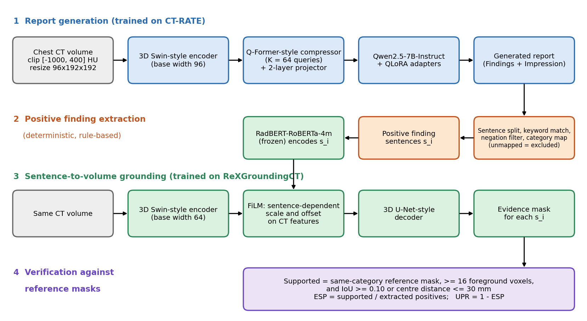

[Home](../) · [AI Papers](./)

# EviGround-CT：LLM 寫的胸部 CT 報告逐句送去 3D 定位查核，整句當查詢讓 137 個生成發現中有標註支持的比例從 0.263 升到 0.365，但參考遮罩不完整、評估只有 100 例

## 來源

- 團隊：Technical University of Munich；共 3 位作者：Ziyuan Li、Juncheng Ni、Feng Li（通訊作者，另屬 Munich Center for Machine Learning）。[(ref: main)](https://arxiv.org/html/2610.33038v1)
- 論文：*EviGround-CT: Sentence-to-Volume Grounding for Verifying LLM-Generated Chest CT Reports*，arXiv v1（cs.CL，交叉列於 cs.CV、cs.LG），2026 年 10 月 15 日提交；arXiv 頁面註記已獲 IEEE BIBM 2026 接受。[(ref: abstract)](https://arxiv.org/abs/2610.33038)
- 識別碼：[arXiv:2610.33038](https://arxiv.org/abs/2610.33038)；[DOI: 10.48550/arXiv.2610.33038](https://doi.org/10.48550/arXiv.2610.33038)。
- 全文：[arXiv HTML v1](https://arxiv.org/html/2610.33038v1)；論文沒有附程式碼連結。
- 研究性質：完整方法論文，報告生成器與定位驗證器都已實作並訓練。報告生成在 CT-RATE 的 1,000 例測試集評估；定位與生成報告查核只在作者從 ReXGroundingCT 公開訓練集保留的 100 例上評估，生成報告抽出 137 個可查核的陽性發現；單一訓練 seed，主要比較附 1,000 次 case-level bootstrap 的 95% CI；沒有外部資料集，也沒有放射科醫師審閱。[(ref: main §V-A)](https://arxiv.org/html/2610.33038v1#S5.SS1) [(ref: main §V-B)](https://arxiv.org/html/2610.33038v1#S5.SS2) [(ref: main §V-D)](https://arxiv.org/html/2610.33038v1#S5.SS4)
- 證據邊界：本文依 arXiv HTML v1 正文（§I–§VIII、Table I–V、Fig. 1–2）撰寫；文中流程圖為本書庫依論文 §IV 重繪，未轉載論文圖片。

**編輯：** Clare

EviGround-CT 在胸部 CT 報告生成之後加一道查核：把報告裡的陽性發現句逐句抽出，連同整句文字（含部位、側別與描述）送進 3D 定位模型預測證據遮罩，再和參考遮罩比對；在 100 例保留資料、同一批 137 個生成發現上，以整句當查詢時有標註支持的比例（ESP）為 0.365，比只給發現類別的 0.263 高 0.102（95% CI 0.028 至 0.181），但參考遮罩並不完整，作者明說剩下的 0.635 不能當成臨床幻覺率。[(ref: main Abstract)](https://arxiv.org/html/2610.33038v1) [(ref: main Table IV)](https://arxiv.org/html/2610.33038v1#S6.T4) [(ref: main §VII)](https://arxiv.org/html/2610.33038v1#S7)

## 流程

圖：本書庫依論文 §IV 與 §V-D 重繪的編輯示意圖，不含成效數值。圖分四段，左側以編號 1 至 4 的彩色標題標示。第一列（標題 1，藍色）由左至右五個方塊：灰框的胸部 CT（裁切到 [−1000, 400] HU、縮放為 96×192×192），以及四個藍框：base width 96 的 3D Swin-style 編碼器、K = 64 個 query 的 Q-Former-style 壓縮器加兩層 projector、Qwen2.5-7B-Instruct 加 QLoRA adapters、生成的報告（Findings + Impression）。第二列（標題 2，橘色）由右至左三個方塊：橘框的切句、關鍵字比對、否定句過濾與類別對應（無法對應者排除），橘框的陽性發現句 s_i，以及綠框的凍結 RadBERT-RoBERTa-4m。第三列（標題 3，綠色）由左至右：灰框的同一個 CT，以及四個綠框：base width 64 的 3D Swin-style 編碼器、以句子決定 scale 與 offset 的 FiLM、3D U-Net-style 解碼器、每一句的證據遮罩；RadBERT 方塊有箭頭向下接到 FiLM。最下方（標題 4，紫色）為一個寬的紫框，寫出支持判定（同類別參考遮罩、至少 16 個前景 voxel、IoU ≥ 0.10 或中心距離 ≤ 30 mm）與 ESP、UPR 的定義。所有箭頭皆為黑色實線。[(ref: main §IV, Fig. 1)](https://arxiv.org/html/2610.33038v1#S4) [(ref: main §IV-E)](https://arxiv.org/html/2610.33038v1#S4.SS5) [(ref: main §V-D)](https://arxiv.org/html/2610.33038v1#S5.SS4)

## 背景／問題

作者的出發點是：由 LLM 生成的胸部 CT 報告，可能寫出在掃描中找不到局部證據的陽性發現。這是論文的動機前提；論文沒有引用量化這個問題發生頻率的研究，而本篇自己算出的「未獲標註支持」比例又受參考遮罩不完整影響，作者也明說它不是臨床幻覺率，因此「生成報告常寫出無證據的發現」在本文只能當作作者的前提，不是已量化的事實。[(ref: main §I)](https://arxiv.org/html/2610.33038v1#S1) [(ref: main §VII)](https://arxiv.org/html/2610.33038v1#S7)

作者指出既有的報告評估方式不檢驗空間對應：詞彙相似度（BLEU、ROUGE 等）與發現層級的一致性只比文字或標籤；例如類別層級的比對會把「右上葉結節」與「左下葉結節」視為同一件事。論文因此主張把整句、包括寫出的部位當作 3D 定位的查詢。[(ref: main §I)](https://arxiv.org/html/2610.33038v1#S1)

論文要回答的是：在相同的生成報告、相同的抽出發現上，用整句當定位查詢的驗證器，是否比只用發現類別的驗證器讓更多發現對到有標註的空間證據。報告查核能否減少臨床錯誤、放射科醫師是否會採用這些遮罩，不在本篇的評估範圍內。

## 方法摘要

EviGround-CT 分三段推論：報告生成器從 CT volume 寫出報告；確定性的抽取器把陽性發現句挑出來；以句子為條件的 3D 定位驗證器為每一句預測證據遮罩。生成器與驗證器分開訓練，各用一個 3D Swin-style 編碼器，作者的理由是報告生成需要精簡的語意 token，定位則需要能做 voxel 層級預測的空間特徵。[(ref: main §I)](https://arxiv.org/html/2610.33038v1#S1) [(ref: main §IV)](https://arxiv.org/html/2610.33038v1#S4)

生成器把 CT 特徵壓成 64 個 soft visual token 接在指令前，交給以 QLoRA 微調的 Qwen2.5-7B-Instruct 生成 Findings 與 Impression。驗證器以凍結的 RadBERT 編碼整句，經 feature-wise linear modulation（FiLM）調變 CT 特徵後，由 3D U-Net-style 解碼器輸出遮罩。查核時，預測遮罩要對到同類別的參考遮罩並通過空間門檻才算「有標註支持」，支持的比例即 evidence-supported precision（ESP）。[(ref: main §IV-B)](https://arxiv.org/html/2610.33038v1#S4.SS2) [(ref: main §IV-D)](https://arxiv.org/html/2610.33038v1#S4.SS4) [(ref: main §IV-E)](https://arxiv.org/html/2610.33038v1#S4.SS5)

## 方法詳解

- **CT 前處理** — 單通道 CT 裁切到 [−1000, 400] HU、正規化到 [−1, 1]，縮放為 96 × 192 × 192；定位遮罩做同樣的空間轉換，以最近鄰內插。[(ref: main §IV-A)](https://arxiv.org/html/2610.33038v1#S4.SS1)
- **報告生成器** — 3D Swin-style 編碼器（base width 96）產生階層特徵，最後一層攤平成 token；Q-Former-style 壓縮器以 K = 64 個可學習 query 做 cross-attention（4 層、hidden size 768），再經兩層 projector 映射到 Qwen2.5-7B-Instruct 的 embedding 空間，作為指令前的 soft visual token。以 QLoRA 凍結量化後的 LLM，LoRA adapters 與 CT 編碼器、壓縮器、projector 一起訓練（rank 32、alpha 64、dropout 0.05），只對目標 token 計算 next-token loss。目標文字為去除 metadata 後的 Findings 與 Impression；推論採確定性解碼，最多 512 個新 token。[(ref: main §IV-B)](https://arxiv.org/html/2610.33038v1#S4.SS2) [(ref: main §V-B)](https://arxiv.org/html/2610.33038v1#S5.SS2)
- **陽性發現抽取** — 確定性規則：切句、關鍵字比對、否定句過濾、類別對應。可查核類別包括結節、腫塊、毛玻璃樣病灶、實質化、肺塌陷、肋膜積液、肺氣腫、纖維化／疤痕與其他 opacity 相關發現；「no pleural effusion」這類否定句排除；無法對應類別的候選記為 out-of-scope，不計入 ESP 與 UPR。整句送去定位，類別標籤只用於和參考遮罩配對。[(ref: main §IV-C)](https://arxiv.org/html/2610.33038v1#S4.SS3)
- **定位驗證器** — 另一個較窄的 3D Swin-style 編碼器（base width 64，作者說明是為了降低 3D 解碼成本）；凍結的 RadBERT-RoBERTa-4m 把句子編成向量，經 MLP 得到 FiLM 的 scale γ_i 與 offset β_i 調變 CT 特徵，同一個 volume 因此可對不同句子產生不同遮罩；3D U-Net-style 解碼器輸出遮罩。以 ReXGroundingCT 的參考句子與遮罩配對訓練，損失為 Dice loss 加 0.5 倍 BCE，以驗證集 Dice early stopping；推論時機率 ≥ 0.5 為前景。[(ref: main §IV-D)](https://arxiv.org/html/2610.33038v1#S4.SS4) [(ref: main §V-B)](https://arxiv.org/html/2610.33038v1#S5.SS2)
- **支持判定與 ESP** — 生成的發現依報告順序處理；每個預測遮罩配對到尚未被用掉、同類別、IoU 最高的參考遮罩（同分取中心距離最近）。只有當預測遮罩至少有 16 個前景 voxel，且配對通過 IoU ≥ 0.10 或中心距離 ≤ 30 mm 其中之一時，才算有標註支持，也只有被支持的配對會用掉參考遮罩。ESP = 被支持數 ÷ 抽出的可查核陽性發現數（包含沒有任何參考可配對者），unsupported positive finding rate（UPR）= 1 − ESP。另設 relaxed（0.05、40 mm）與 strict（0.20、20 mm）兩組門檻。[(ref: main §IV-E)](https://arxiv.org/html/2610.33038v1#S4.SS5) [(ref: main §V-D)](https://arxiv.org/html/2610.33038v1#S5.SS4)
- **基線與消融** — 報告生成基線為 CT2Rep-style 模型，以及凍結 Qwen2.5、只訓練視覺 projector 的版本；定位基線為中心／肺部先驗、Grad-CAM（以同類別訓練的多標籤 3D 分類器最後一層特徵，正規化後以 > 0.5 二值化）、只給類別標籤的 category conditioning，以及把 RadBERT 換成凍結 RoBERTa-base。消融分別拿掉 LLM adapters、視覺壓縮、文字條件，或改成共用一個 CT 編碼器。可訓練的基線使用相同切分、前處理、優化器家族與 early stopping。[(ref: main §V-C)](https://arxiv.org/html/2610.33038v1#S5.SS3)
- **訓練環境** — AdamW、bfloat16、gradient checkpointing、梯度累積與 gradient clipping；兩張 NVIDIA H100，random seed 42；結果取驗證集最佳 checkpoint，不確定性以 case-level bootstrap 估計。[(ref: main §V-B)](https://arxiv.org/html/2610.33038v1#S5.SS2)
- **論文未交代** — 學習率、batch size、訓練步數或 epoch 數；給 LLM 的指令 prompt 原文；抽取器的關鍵字清單與類別對應規則細節；CT2Rep-style 基線的實作細節；CT-RATE 子集「保留異常多樣性與正常／異常平衡」的具體抽樣方式；finding F1 的彙總方式（micro 或 macro）；所有結果都來自單一 seed，不含訓練隨機性的變異；論文沒有附程式碼。

## 資料與實驗

下表整理論文使用的資料與評估角色。[(ref: main §V-A)](https://arxiv.org/html/2610.33038v1#S5.SS1)

| 資料 | 角色 | 規模與說明（論文所述） |
|---|---|---|
| CT-RATE（case-disjoint 子集） | 報告生成的訓練／驗證／測試 | 8,000／1,000／1,000 組 CT–報告配對；以 case／volume 識別碼對到 ReXGroundingCT 驗證或保留評估案例的 CT-RATE 訓練案例被排除 |
| ReXGroundingCT 公開訓練集（扣除保留部分） | 定位驗證器訓練 | 2,892 例 |
| ReXGroundingCT 公開驗證集 | checkpoint 與門檻選擇 | 50 例 |
| ReXGroundingCT 保留子集 | oracle 定位、生成報告查核、門檻敏感度、消融 | 從公開訓練集保留 100 例；官方 100 例私有測試集（ReXrank）的遮罩未公開，因此未使用；保留子集沿用公開釋出、非窮盡的遮罩作為參考證據 |

報告品質以 BLEU-4、ROUGE-L、METEOR、CIDEr 與 finding F1 評估，finding F1 以同一套規則把生成與參考報告對應到預定類別。oracle 定位把每個參考句子與其配對遮罩比較，報告 Dice、IoU、localization accuracy（通過空間準則的比例）與中心距離誤差；Dice／IoU 以 ≥ 0.5 為前景、分子分母各加 10⁻⁶ 平滑，兩個空遮罩記為 1。生成報告查核則報告 ESP，以及有同類別參考可配對者的 Dice／IoU。所有 CI 為 1,000 次 case-level bootstrap，並對同一批生成發現計算 paired ESP 差。[(ref: main §V-D)](https://arxiv.org/html/2610.33038v1#S5.SS4)

下表重製論文 Table I：CT-RATE 測試集的報告生成，數值越高越好。[(ref: main Table I)](https://arxiv.org/html/2610.33038v1#S6.T1)

| Method | BLEU-4 | ROUGE-L | METEOR | CIDEr | Finding F1 |
|---|---|---|---|---|---|
| CT2Rep-style | 0.183 | 0.331 | 0.182 | 0.219 | 0.158 |
| Frozen Qwen2.5 | 0.167 | 0.308 | 0.164 | 0.181 | 0.143 |
| Qwen2.5-QLoRA | 0.211 | 0.359 | 0.206 | 0.287 | 0.221 |

下表重製論文 Table II：在 ReXGroundingCT 保留子集上，以參考句子做 oracle 定位。Loc. acc. 為 localization accuracy，Dist. 為中心距離誤差。[(ref: main Table II)](https://arxiv.org/html/2610.33038v1#S6.T2)

| Method | Dice ↑ | IoU ↑ | Loc. acc. ↑ | Dist. (mm) ↓ |
|---|---|---|---|---|
| Center/lung prior | 0.055 | 0.031 | 0.177 | 63.5 |
| Grad-CAM | 0.176 | 0.115 | 0.356 | 47.8 |
| Category decoder | 0.210 | 0.133 | 0.514 | 31.0 |
| RoBERTa-base decoder | 0.288 | 0.179 | 0.622 | 24.9 |
| EviGround-CT | 0.375 | 0.239 | 0.724 | 18.2 |

下表重製論文 Table III：ReXGroundingCT 保留子集上的生成報告查核；category 與 sentence 兩列使用同一個 Qwen2.5-QLoRA 生成器與同一批抽出的發現，CAM 為輔助分類器的 Grad-CAM。[(ref: main Table III)](https://arxiv.org/html/2610.33038v1#S6.T3)

| Generator + verifier | Dice ↑ | IoU ↑ | ESP ↑ |
|---|---|---|---|
| CT2Rep-style + CAM | 0.142 | 0.091 | 0.122 |
| Qwen2.5-QLoRA + CAM | 0.159 | 0.104 | 0.249 |
| Qwen2.5-QLoRA + category | 0.199 | 0.123 | 0.263 |
| Qwen2.5-QLoRA + sentence | 0.286 | 0.169 | 0.365 |

下表重製論文 Table IV：137 個生成發現在三組空間門檻下的 ESP 與 paired 差，括號為 95% case-level bootstrap CI；ΔESP 為 sentence 減 category。被支持的發現數（category／sentence）依序為 45／61、36／50、23／35。[(ref: main Table IV)](https://arxiv.org/html/2610.33038v1#S6.T4)

| Criterion | Category | Sentence | ΔESP |
|---|---|---|---|
| Relaxed | 0.328 [0.255, 0.411] | 0.445 [0.365, 0.529] | +0.117 [0.043, 0.197] |
| Default | 0.263 [0.196, 0.342] | 0.365 [0.289, 0.448] | +0.102 [0.028, 0.181] |
| Strict | 0.168 [0.115, 0.239] | 0.255 [0.190, 0.334] | +0.088 [0.021, 0.164] |

下表重製論文 Table V：ReXGroundingCT 保留子集上的生成與查核消融；Dice 與 ESP 為生成報告查核的數值，finding F1 以該子集的參考報告計算，N/A 表示論文未報告。[(ref: main Table V)](https://arxiv.org/html/2610.33038v1#S6.T5)

| Variant | Finding F1 | Dice | ESP |
|---|---|---|---|
| Full EviGround-CT | 0.218 | 0.286 | 0.365 |
| Without LLM adapters | 0.132 | N/A | 0.197 |
| Without Q-Former | 0.146 | N/A | 0.199 |
| Without text conditioning | N/A | 0.148 | 0.221 |
| RoBERTa-base encoder | N/A | 0.240 | 0.303 |
| Shared CT encoder | N/A | 0.232 | 0.299 |

## 結果

- **報告生成在五項指標都高於兩個基線** — CT-RATE 測試集上，Qwen2.5-QLoRA 生成器的 BLEU-4 從 CT2Rep-style 的 0.183 升到 0.211、CIDEr 從 0.219 升到 0.287；finding F1 為 0.221，CT2Rep-style 為 0.158、只訓練 projector 的凍結 Qwen2.5 為 0.143。[(ref: main §VI-A)](https://arxiv.org/html/2610.33038v1#S6.SS1) [(ref: main Table I)](https://arxiv.org/html/2610.33038v1#S6.T1)
- **給參考句子時，句子條件的定位明顯優於類別條件** — oracle 定位中，RadBERT 版本的 Dice 0.375、localization accuracy 0.724、中心距離誤差 18.2 mm；換成 RoBERTa-base 為 0.288、0.622、24.9 mm；只給類別為 0.210、0.514、31.0 mm；Grad-CAM 與中心／肺部先驗更低。[(ref: main §VI-B)](https://arxiv.org/html/2610.33038v1#S6.SS2) [(ref: main Table II)](https://arxiv.org/html/2610.33038v1#S6.T2)
- **同一批生成發現上，整句查詢讓 ESP 高約 0.10** — 137 個抽出的可查核陽性發現中，整句條件有 50 個通過預設準則、類別條件有 36 個，ESP 為 0.365 對 0.263，paired 差 +0.102（95% CI 0.028 至 0.181）；UPR 對應從 0.737 降到 0.635，配對後的 Dice 從 0.199 升到 0.286、IoU 從 0.123 升到 0.169。[(ref: main §VI-C)](https://arxiv.org/html/2610.33038v1#S6.SS3) [(ref: main Table III)](https://arxiv.org/html/2610.33038v1#S6.T3)
- **門檻放寬或收緊，差距方向不變** — relaxed 準則下 paired 差 +0.117（95% CI 0.043 至 0.197），strict 準則下 +0.088（95% CI 0.021 至 0.164），三組 CI 都在零以上；但收緊準則時兩種驗證器的 ESP 都明顯下降，strict 下整句條件只剩 0.255。[(ref: main §VI-C)](https://arxiv.org/html/2610.33038v1#S6.SS3) [(ref: main Table IV)](https://arxiv.org/html/2610.33038v1#S6.T4)
- **ESP 也受生成器影響** — 同樣用 Grad-CAM 當驗證器，CT2Rep-style 生成的報告 ESP 為 0.122，Qwen2.5-QLoRA 為 0.249；消融中拿掉 LLM adapters 或拿掉 Q-Former，ESP 分別降到 0.197 與 0.199，finding F1 也降到 0.132 與 0.146。作者的解讀是生成器決定哪些陳述進入查核，驗證器負責找證據。[(ref: main Table III)](https://arxiv.org/html/2610.33038v1#S6.T3) [(ref: main §VI-E)](https://arxiv.org/html/2610.33038v1#S6.SS5) [(ref: main §VII)](https://arxiv.org/html/2610.33038v1#S7)
- **驗證器端的消融以拿掉文字條件影響最大** — 拿掉文字條件時查核 Dice 從 0.286 降到 0.148、ESP 降到 0.221；換成 RoBERTa-base 為 0.240 與 0.303；改用共用 CT 編碼器為 0.232 與 0.299。[(ref: main §VI-E)](https://arxiv.org/html/2610.33038v1#S6.SS5) [(ref: main Table V)](https://arxiv.org/html/2610.33038v1#S6.T5)
- **定性例子** — 論文 Fig. 2 展示右中葉 opacity、左側肋膜積液與毛玻璃相關線狀 opacity 三例：參考報告寫右中葉「focal consolidative density」、生成報告寫同葉「air-space opacity」，兩者遮罩在對應區域重疊；肋膜積液例中參考寫 10 mm、生成寫 1 cm 並保留左側；作者也指出三例都有邊界不一致。[(ref: main §VI-D, Fig. 2)](https://arxiv.org/html/2610.33038v1#S6.SS4)

## 限制

- **作者自述** — ESP 與 UPR 衡量的是對「現有標註」的支持；保留子集的遮罩並非窮盡標註，因此 UPR 不是臨床幻覺率。需要外部資料與放射科醫師審閱，才能評估標註遺漏的發現，並把查核延伸到陰性與不確定的陳述。[(ref: main §VII)](https://arxiv.org/html/2610.33038v1#S7)
- **本書庫補充：評估規模小，且只有一個 seed** — 查核結論建立在 100 例、137 個生成發現上；bootstrap CI 只反映病例抽樣，不含訓練隨機性。ESP 差的 CI 下界在預設準則為 0.028，方向一致但幅度的不確定性大。[(ref: main §V-B)](https://arxiv.org/html/2610.33038v1#S5.SS2) [(ref: main Table IV)](https://arxiv.org/html/2610.33038v1#S6.T4)
- **本書庫補充：「有標註支持」的空間門檻寬鬆** — 預設準則只要 IoU ≥ 0.10 或中心距離 ≤ 30 mm 其一成立；在這個門檻下，整句條件的配對 Dice 仍只有 0.286。ESP 適合比較兩種查詢方式，不代表遮罩已精準畫出病灶。[(ref: main §V-D)](https://arxiv.org/html/2610.33038v1#S5.SS4) [(ref: main Table III)](https://arxiv.org/html/2610.33038v1#S6.T3)
- **本書庫補充：只查陽性、只查預設類別** — 否定句與無法對應類別的陳述不進入查核，報告漏寫的發現也不在 ESP 的分母或分子裡；ESP 高不等於報告完整或正確。[(ref: main §IV-C)](https://arxiv.org/html/2610.33038v1#S4.SS3) [(ref: main §IV-E)](https://arxiv.org/html/2610.33038v1#S4.SS5)
- **本書庫補充：保留子集不是官方測試集** — 因官方測試遮罩未公開，評估用的 100 例取自 ReXGroundingCT 公開訓練集，checkpoint 與門檻以 50 例驗證集選擇；CT-RATE 與 ReXGroundingCT 之間的重疊由作者以 case／volume 識別碼排除。這組結果尚未在其他醫院或其他標註來源上檢驗。[(ref: main §V-A)](https://arxiv.org/html/2610.33038v1#S5.SS1)
- **本書庫補充：生成器的比較對象有限** — 報告生成只對照 CT2Rep-style 與凍結 Qwen2.5 兩個基線，且論文只稱為「CT2Rep-style」模型，沒有說明與原始 CT2Rep 的異同；Table I 的結果不足以說明這個生成器在 3D CT 報告生成整體中的位置。[(ref: main §V-C)](https://arxiv.org/html/2610.33038v1#S5.SS3)

## 與書庫其他文章的關係

MAIRA-2 在生成胸片報告時就把每個發現連同定位框一起輸出，EviGround-CT 則在胸部 CT 報告寫完之後，另用一個以整句為查詢的 3D 驗證器替每個陽性發現找證據遮罩，兩篇代表「生成時定位」與「生成後查核」兩種把報告句連回影像的做法: [MAIRA-2：胸腔 X 光報告的文字正確，定位也正確嗎？](2026-09-15-maira-2-grounded-reporting.md)

該研究用 LLM 查核胸片報告句是否成立，並顯示「未提到」的解讀約定會改變量到的分數；EviGround-CT 則用 3D 遮罩對參考標註查核 CT 報告句，同樣面對參考不完整的問題，作者明說 UPR 不能讀成幻覺率，兩篇都提醒報告查核的分數受參考約定左右: [「沒提到」算不算「沒有」？RL 訓練的胸片 checklist 讓報告句查核在保留病人上 Y 升 12.6 個百分點（rule-based 查核；換成 MedGemma-4B 是 11.8），但換一個查核模型或格式，量到的增益就跟著變](2026-10-23-unmentioned-findings-rl-cxr-report-checking.md)

## 實務的啟發

這是一篇完整實作、但評估規模很小的方法論文：查核的主要證據來自 100 例、137 個發現與單一 seed，參考遮罩又不完整。比較適合當作「如何替生成報告的每一句找影像證據」的設計與量測參考，不是可直接部署的報告查核器。

第一，可借用的是把查核做成獨立的後處理：生成器與驗證器分開訓練，驗證器只吃「整句 + 同一個 CT」，因此可以接在任何報告生成器後面，也能拿來比較不同生成器。論文中同一個 CAM 驗證器對兩個生成器量到 0.122 與 0.249 的 ESP，說明這個量測對生成器敏感。[(ref: main Table III)](https://arxiv.org/html/2610.33038v1#S6.T3)

第二，可借用的是比較設計：兩種驗證器在完全相同的生成發現上計分，再報告 paired bootstrap 差與多組空間門檻的敏感度。院內若要評估定位查核，本書庫認為這比只報告單一 ESP 數字更能判斷改善是否穩定。[(ref: main Table IV)](https://arxiv.org/html/2610.33038v1#S6.T4)

第三，待驗證的警訊是分數的解讀。UPR 0.635 混合了「報告寫錯」「驗證器沒找到」與「參考沒有標」三種來源，論文沒有拆開；在有放射科醫師逐句審閱之前，不宜把 UPR 當成生成報告的幻覺率，也不宜把被判為「有支持」的遮罩直接展示給臨床人員當作證據。[(ref: main §VII)](https://arxiv.org/html/2610.33038v1#S7)

第四，若要沿用，至少需要補上論文未給的訓練超參數、prompt 與抽取規則，並在官方測試集或院內資料上，用不同 seed 重跑，確認 ESP 差仍在零以上。

## References

- `main`：[EviGround-CT: Sentence-to-Volume Grounding for Verifying LLM-Generated Chest CT Reports，arXiv HTML v1](https://arxiv.org/html/2610.33038v1)；本文使用 [§I Introduction](https://arxiv.org/html/2610.33038v1#S1)、[§IV Method 與 Fig. 1](https://arxiv.org/html/2610.33038v1#S4)、[§IV-A](https://arxiv.org/html/2610.33038v1#S4.SS1)、[§IV-B](https://arxiv.org/html/2610.33038v1#S4.SS2)、[§IV-C](https://arxiv.org/html/2610.33038v1#S4.SS3)、[§IV-D](https://arxiv.org/html/2610.33038v1#S4.SS4)、[§IV-E](https://arxiv.org/html/2610.33038v1#S4.SS5)、[§V-A](https://arxiv.org/html/2610.33038v1#S5.SS1)、[§V-B](https://arxiv.org/html/2610.33038v1#S5.SS2)、[§V-C](https://arxiv.org/html/2610.33038v1#S5.SS3)、[§V-D](https://arxiv.org/html/2610.33038v1#S5.SS4)、[§VI-A](https://arxiv.org/html/2610.33038v1#S6.SS1)、[Table I](https://arxiv.org/html/2610.33038v1#S6.T1)、[§VI-B](https://arxiv.org/html/2610.33038v1#S6.SS2)、[Table II](https://arxiv.org/html/2610.33038v1#S6.T2)、[§VI-C](https://arxiv.org/html/2610.33038v1#S6.SS3)、[Table III](https://arxiv.org/html/2610.33038v1#S6.T3)、[Table IV](https://arxiv.org/html/2610.33038v1#S6.T4)、[§VI-D 與 Fig. 2](https://arxiv.org/html/2610.33038v1#S6.SS4)、[§VI-E](https://arxiv.org/html/2610.33038v1#S6.SS5)、[Table V](https://arxiv.org/html/2610.33038v1#S6.T5)、[§VII Discussion](https://arxiv.org/html/2610.33038v1#S7)。
- `abstract`：[arXiv:2610.33038](https://arxiv.org/abs/2610.33038)。
- `doi`：[10.48550/arXiv.2610.33038](https://doi.org/10.48550/arXiv.2610.33038)。

[Home](../) · [AI Papers](./)
