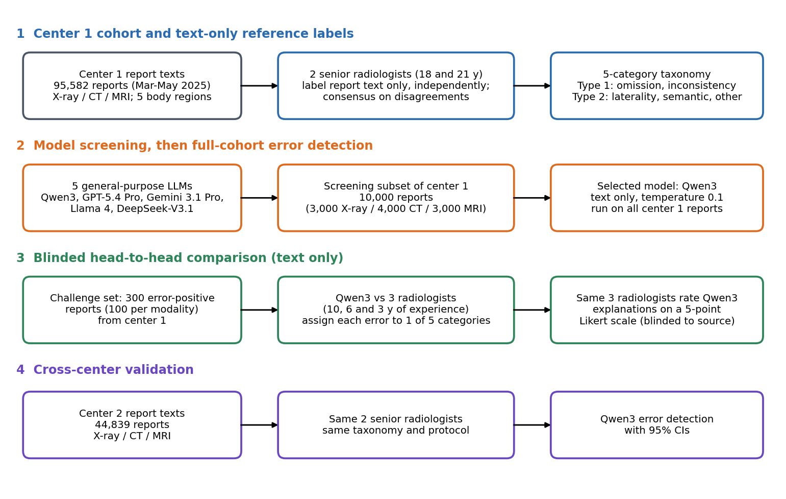

[Home](../) · [AI Papers](./)

# 14 萬份中文報告挑錯：Qwen3 recall 0.96，醫師最高 0.67

## 來源

- 團隊：昆明醫科大學第二附屬醫院放射科（中心 1）、昆明醫科大學第六附屬醫院放射科（中心 2，玉溪），以及電子科技大學資訊與軟體工程學院、上海科技大學生物醫學工程學院、University of Cambridge 放射科、阜外醫院放射科、Stanford Center for Artificial Intelligence in Medicine and Imaging；共 17 位作者，第一作者 Lujing Wang，共同通訊作者 Jian Ma、Xinxiang Zhao。[(ref: main)](https://www.jmir.org/2026/1/e106250)
- 論文：*Large Language Model–Assisted Radiology Report Quality Assurance: Real-World Multicenter Evaluation*，*Journal of Medical Internet Research* 2026;28:e106250，2026 年 10 月 28 日刊出；較早的預印本版本於 2026 年 7 月 6 日首次公開。[(ref: main)](https://www.jmir.org/2026/1/e106250)
- 識別碼：[DOI: 10.2196/106250](https://doi.org/10.2196/106250)。
- 全文：[出版社 HTML 全文](https://www.jmir.org/2026/1/e106250)，CC BY 4.0；完整資料因資料保護規定未公開，須經機構核准與資料使用協議向通訊作者申請。[(ref: main)](https://www.jmir.org/2026/1/e106250)
- 研究性質：完整的回溯性評估研究，不是 pilot。被評估的是現成通用 LLM 以 prompt 審閱報告文字，沒有微調；評估涵蓋中心 1 的 95,582 份報告、中心 2 的 44,839 份報告，以及 300 份含錯報告上與三位放射科醫師的盲化比較。中心 1 的指標沒有附 CI，中心 2 的指標附 95% CI。[(ref: main Methods)](https://www.jmir.org/2026/1/e106250#Methods) [(ref: main Results)](https://www.jmir.org/2026/1/e106250#Results)
- 證據邊界：本文依出版社 HTML 正文、Table 1 與 Figure 1–6 的圖說撰寫；quality-check prompt 原文與補充圖表（Figure S1–S2、Table S1–S16）位於 Multimedia Appendix 1，未納入本文引述。文中流程圖為本書庫依論文 Methods 重繪，未轉載論文圖片。

**編輯：** Clare

這篇研究把放射報告的「文字內部錯誤」（漏寫、描述與結論矛盾、左右寫反、用字錯誤、編號或單位錯誤）交給通用 LLM 審閱，選出的 Qwen3 在中心 1 的 95,908 個標註實例上 macro-F1 0.94、在外院中心 2 為 0.93（95% CI 0.91–0.94），在 300 份含錯報告上把錯誤挑出並分對類別的比例為 0.96、三位放射科醫師為 0.45–0.67，但這是只看報告文字、不看影像的任務，比較集也只含有錯的報告。[(ref: main Abstract)](https://www.jmir.org/2026/1/e106250#Abstract) [(ref: main Results)](https://www.jmir.org/2026/1/e106250#Results)

## 流程

圖：本書庫依論文 Methods 重繪的研究設計示意圖，不含成效數值。圖分四列，每列左上方有編號 1 至 4 的彩色粗體標題，每列三個圓角方框以黑色實線箭頭由左至右相連。第一列（標題 1，藍色）：灰框的中心 1 報告文字（95,582 份，2025 年 3 至 5 月；X 光、CT、MRI，5 個身體部位），藍框的兩位資深放射科醫師（18 與 21 年經驗）各自只看報告文字標註、意見不一致時共識裁定，以及藍框的五類錯誤分類法（Type 1：omission、inconsistency；Type 2：laterality、semantic、other）。第二列（標題 2，橘色）三個橘框：五個通用 LLM（Qwen3、GPT-5.4 Pro、Gemini 3.1 Pro、Llama 4、DeepSeek-V3.1）、中心 1 的 10,000 份篩選子集（X 光 3,000、CT 4,000、MRI 3,000），以及選定的 Qwen3（只輸入文字、temperature 0.1，跑完中心 1 全部報告）。第三列（標題 3，綠色）三個綠框：來自中心 1、300 份含錯報告的 challenge set（每種檢查各 100 份），Qwen3 對三位放射科醫師（10、6、3 年經驗）把每個錯誤歸入五類之一，以及同三位醫師以 5 分 Likert 量表、在不知來源的情況下評分 Qwen3 的解釋。第四列（標題 4，紫色）三個紫框：中心 2 報告文字（44,839 份；X 光、CT、MRI），同兩位資深醫師以相同分類法與流程標註，以及附 95% CI 的 Qwen3 偵錯評估。[(ref: main Methods, Figure 1)](https://www.jmir.org/2026/1/e106250#figure1) [(ref: main Table 1)](https://www.jmir.org/2026/1/e106250#table1)

## 背景／問題

作者的出發點是放射科工作量增加、人工複核難以大規模抓出報告裡的細小錯誤。論文在引言中寫道中國三級醫院放射科每日產出逾 10,000 份報告、資深醫師每天複核逾 100 份，並引用文獻指出報告錯誤率可高達 15% 至 20%；這些數字是作者引用的背景，不是本研究量到的結果。本研究自己在中心 1 的 95,582 份報告中，確認至少含一處文字內部錯誤的是 4.6%，而且只計入從報告文字就能判斷的錯誤，兩者的定義與範圍不同，不宜互相比較。[(ref: main Introduction)](https://www.jmir.org/2026/1/e106250#Introduction) [(ref: main Results)](https://www.jmir.org/2026/1/e106250#Results)

作者指出先前的 LLM 報告查錯研究多限於單一檢查（例如胸片）或人工植入錯誤的資料集。本研究要回答的是：在真實、跨 X 光／CT／MRI 與多個身體部位、跨兩家醫院的中文報告上，通用 LLM 能否偵測並正確分類文字內部錯誤，與不同年資的放射科醫師相比如何。報告與影像是否相符、錯誤的臨床嚴重度、導入後能否減少錯誤，都不在本研究的評估範圍內。[(ref: main Introduction)](https://www.jmir.org/2026/1/e106250#Introduction) [(ref: main Discussion)](https://www.jmir.org/2026/1/e106250#Discussion)

## 方法摘要

研究先建立參考標準：兩位資深放射科醫師只看報告文字，依五類錯誤分類法獨立標註中心 1 的全部報告，不一致時共識裁定。接著五個通用 LLM 透過同一個 OpenAI 相容的雲端 API，在 10,000 份隨機子集上比較，表現最好的 Qwen3 再跑完中心 1 全部報告。模型只收到報告文字，輸出是否有錯、錯在哪一類，並附上解釋。[(ref: main Methods)](https://www.jmir.org/2026/1/e106250#Methods)

之後有三項延伸評估：在 300 份確認含錯的報告上，Qwen3 與三位不同年資的放射科醫師盲化比較挑錯與分類；同三位醫師以 Likert 量表評 Qwen3 的解釋；最後在中心 2 的 44,839 份報告上做外部驗證，由同兩位資深醫師以相同流程標註。[(ref: main Methods)](https://www.jmir.org/2026/1/e106250#Methods)

## 方法詳解

- **資料與去識別** — 中心 1 收錄 2025 年 3 至 5 月的 X 光、CT、MRI 報告，涵蓋頭部、胸部、腹部、脊椎、膝部；納入條件為含檢查方式、部位、影像所見與診斷結論的完整報告，排除急診與功能性影像。所有報告由住院醫師至主治醫師（1–7 年）初擬、資深醫師（≥ 8 年）複核。匯出時移除姓名、性別、年齡、住院號、檢查號、日期、院名與醫師名等識別資訊，只保留檢查方式、檢查項目、影像所見與診斷結論，對照檔留在院內、不提供給任何模型或第三方平台。[(ref: main Methods)](https://www.jmir.org/2026/1/e106250#Methods)
- **錯誤分類法** — 五類互斥：omission（影像所見有寫、結論沒寫，或結論有診斷、所見沒有對應描述）、inconsistency（所見與結論邏輯矛盾）、laterality confusion（側別或方位錯誤）、semantic error（誤植字詞、錯字、無關內容）、other error（結論編號、單位、標點造成歧義等）；前兩類合稱 type 1 interpretive errors，後三類合稱 type 2 factual errors，無錯記為 N。只納入從報告文字本身可判斷的錯誤，只有看影像才能發現的漏看不在分類法內。[(ref: main Table 1)](https://www.jmir.org/2026/1/e106250#table1)
- **參考標準** — 兩位資深放射科醫師（18 與 21 年經驗）獨立審閱全部報告，看不到影像、病歷與 LLM 輸出；不一致時共識裁定。共識前的 Cohen κ（報告是否有錯）中心 1 為 0.783（95% CI 0.773–0.792）、中心 2 為 0.850（95% CI 0.837–0.863）；在共識確認含錯的報告中，各類別 κ 為 0.816–0.975（中心 1）與 0.841–0.985（中心 2）。[(ref: main Methods)](https://www.jmir.org/2026/1/e106250#Methods) [(ref: main Results)](https://www.jmir.org/2026/1/e106250#Results)
- **模型與設定** — Qwen3-2507（文中簡稱 Qwen3）、GPT-5.4 Pro、Gemini 3.1 Pro、Llama 4、DeepSeek-V3.1，全部經由 GeekAI 提供的 OpenAI 相容雲端 API 呼叫；temperature 0.1；只輸入報告文字，不給影像或其他資料。五個模型先在 10,000 份隨機子集（X 光 3,000、CT 4,000、MRI 3,000）比較，Qwen3 的偵錯 accuracy 0.96 最高而被選為主模型；其餘四個模型的數值只在補充 Figure S1。[(ref: main Methods)](https://www.jmir.org/2026/1/e106250#Methods) [(ref: main Results)](https://www.jmir.org/2026/1/e106250#Results)
- **人機比較** — challenge set 為從中心 1 共識確認含錯報告中隨機抽出的 300 份（X 光、CT、MRI 各 100），共 335 個錯誤實例。三位放射科醫師（Dr A 10 年、Dr B 6 年、Dr C 3 年）事先學過分類法定義與範例並做 5 份練習（不計入），之後獨立找出所有錯誤並歸類；同樣看不到影像、病歷、參考標註或模型輸出，提交後鎖定不可修改，並記錄每份報告的審閱時間。[(ref: main Methods)](https://www.jmir.org/2026/1/e106250#Methods)
- **比較指標** — report-level sensitivity：含錯報告中至少找到一個錯誤的比例；report-level exact set match：預測的錯誤類別集合與參考完全相同才算對；error instance–level exact category recall：被分到正確類別的參考錯誤實例數 ÷ 全部參考錯誤實例數。全量評估另報 accuracy、balanced accuracy、sensitivity、specificity、PPV、NPV、Matthews correlation coefficient 與 F1（含 macro 與 weighted）。[(ref: main Methods)](https://www.jmir.org/2026/1/e106250#Methods)
- **解釋評分** — 同三位醫師在不知來源的情況下，以 5 分 Likert 量表（5 = strongly agree 至 1 = strongly disagree）評 Qwen3 對 300 份報告的錯誤解釋，每份取三人平均；約 4 個月後對每種檢查各 30 份重評，計算觀察者間與觀察者內 ICC。[(ref: main Methods)](https://www.jmir.org/2026/1/e106250#Methods)
- **外部驗證** — 中心 2（昆明醫科大學第六附屬醫院）的 44,839 份報告，涵蓋 X 光、CT、MRI 與頭、胸、腹、脊椎；由同兩位資深醫師以相同分類法與流程標註。[(ref: main Methods)](https://www.jmir.org/2026/1/e106250#Methods)
- **論文未交代** — quality-check prompt 原文只在補充資料；Qwen3-2507 與 Llama 4 的具體版本或參數規模；模型輸出如何解析成錯誤類別、多個錯誤如何對應到參考實例；10,000 份篩選子集的 accuracy 0.96 是在哪個層級計算，且這個子集同時屬於後續評估的中心 1 全量資料；人機比較 P < .001 所用的檢定方法；中心 1 各項指標的不確定性區間；摘要所報 report-level sensitivity 0.99、specificity 0.99、PPV 0.90、F1 0.94 在正文的對應位置與計算方式（正文文字報的是實例層級的 macro 指標）；中心 2 的錯誤盛行率與錯誤類別分布（在補充表）；匯出的報告是資深醫師複核前還是複核後的版本；資料與程式碼未公開。

## 資料與實驗

下表整理論文使用的資料與評估角色。[(ref: main Methods)](https://www.jmir.org/2026/1/e106250#Methods) [(ref: main Results)](https://www.jmir.org/2026/1/e106250#Results)

| 資料 | 角色 | 規模與說明（論文所述） |
|---|---|---|
| 中心 1：昆明醫科大學第二附屬醫院，2025 年 3–5 月 | 主評估 | 95,582 份報告：X 光 10,036（10.5%）、CT 67,215（70.3%）、MRI 18,331（19.2%）；4,431 份（4.6%）至少含一處確認錯誤；95,908 個標註實例，其中無錯 91,192、錯誤實例 4,716 |
| 中心 1 篩選子集 | 五個 LLM 的比較與選模 | 隨機 10,000 份：X 光 3,000、CT 4,000、MRI 3,000 |
| 中心 1 challenge set | Qwen3 與三位放射科醫師比較、解釋評分 | 從含錯報告隨機抽出 300 份（每種檢查 100 份），335 個錯誤實例：X 光 116、CT 107、MRI 112 |
| 中心 2：昆明醫科大學第六附屬醫院（玉溪） | 外部驗證 | 44,839 份報告：X 光 5,927（13.2%）、CT 32,587（72.7%）、MRI 6,325（14.1%）；44,907 個標註實例 |

下表重製論文 Table 1 的錯誤分類法（範例為論文所舉，原文為中文報告的英譯）。[(ref: main Table 1)](https://www.jmir.org/2026/1/e106250#table1)

| 性質與錯誤類型 | 定義 | 範例 |
|---|---|---|
| Type 1：interpretive errors — Omission | 影像所見有記載、診斷結論沒有；或結論中的診斷在所見裡沒有對應描述 | 結論寫到「右上葉後段結節」，所見沒有提到 |
| Type 1：interpretive errors — Inconsistency | 所見與結論邏輯矛盾 | 所見寫「clear fracture line」，結論寫「no definite fracture」 |
| Type 2：factual errors — Laterality confusion | 側別或方位錯誤 | 「右脛骨骨折」寫成左側；「外側半月板撕裂」寫成內側 |
| Type 2：factual errors — Semantic error | 誤植字詞、錯字、無關內容或詞彙替換 | 插入多餘內容；錯字（論文英譯為「calcification spot」被寫成「calcification zhuang」） |
| Type 2：factual errors — Other error | 上述以外的技術或格式錯誤 | 結論編號錯（Finding 1 標成 Finding 3）；「5 mm」寫成「5 cm」；標點造成歧義 |

論文正文沒有結果表格，數值分散在文字與 Figure 2–6；以下三表由本書庫依正文整理，欄位與數值皆來自正文所列。

中心 1 全量資料上 Qwen3 的各錯誤子類表現（實例層級）。[(ref: main Results, Figure 3)](https://www.jmir.org/2026/1/e106250#figure3)

| 錯誤子類 | Precision | Recall | F1 |
|---|---|---|---|
| Omission（subtype 1） | 0.83 | 0.96 | 0.89 |
| Inconsistency（subtype 2） | 0.75 | 0.93 | 0.83 |
| Laterality confusion（subtype 3） | 正文未列 | 正文未列 | 0.94 |
| Semantic error（subtype 4） | 正文未列 | 正文未列 | 0.98 |
| Other error（subtype 5） | 1.00 | 1.00 | 1.00 |

challenge set 上的 error instance–level exact category recall 與平均每份審閱時間（Dr A／B／C 年資依序為 10、6、3 年）。[(ref: main Results, Figure 4)](https://www.jmir.org/2026/1/e106250#figure4)

| 分層 | Qwen3 | Dr A | Dr B | Dr C |
|---|---|---|---|---|
| 全部（335 個實例） | 0.96（320/335） | 0.67（223/335） | 0.53（178/335） | 0.45（152/335） |
| X 光 | 0.95 | 0.72 | 0.63 | 0.52 |
| CT | 0.96 | 0.64 | 0.51 | 0.50 |
| MRI | 0.96 | 0.62 | 0.45 | 0.35 |
| Type 1 interpretive | 0.94 | 0.62 | 0.58 | 0.51 |
| Type 2 factual | 0.97 | 0.70 | 0.49 | 0.41 |
| 平均審閱時間（秒／份） | 5.80 | 55.80 | 61.20 | 67.80 |

中心 2 外部驗證（實例層級，括號為 95% CI）。[(ref: main Results, Figure 6)](https://www.jmir.org/2026/1/e106250#figure6)

| 分層 | 指標 | 數值 |
|---|---|---|
| 整體 | Accuracy | 1.00（1.00–1.00） |
| 整體 | Balanced accuracy | 0.94（0.92–0.95） |
| 整體 | Macro-precision | 0.92（0.90–0.94） |
| 整體 | Macro-F1 | 0.93（0.91–0.94） |
| 整體 | Weighted F1 | 1.00（1.00–1.00） |
| X 光／CT／MRI | Balanced accuracy | 0.95（0.90–0.98）／0.94（0.91–0.96）／0.92（0.88–0.95） |
| 含錯報告的部位分層：胸／頭／腹／脊椎 | Macro-F1 | 0.97（0.94–0.99）／0.93（0.89–0.97）／0.90（0.86–0.94）／0.84（0.80–0.89） |

## 結果

- **中心 1 全量** — 95,908 個實例上 accuracy 0.99、balanced accuracy 0.98、macro-precision 0.91、macro-F1 0.94、weighted F1 0.99；摘要另報 report-level sensitivity 0.99、specificity 0.99、PPV 0.90、F1 0.94。由於約 95% 的實例無錯，accuracy 與 weighted F1 主要反映無錯報告被判對，macro 指標較能看出錯誤類別上的表現。[(ref: main Abstract)](https://www.jmir.org/2026/1/e106250#Abstract) [(ref: main Results, Figure 2)](https://www.jmir.org/2026/1/e106250#figure2)
- **錯分比例隨檢查與部位而變** — 依檢查分層的錯分比例：X 光 0.5%（52/10,089）、CT 0.6%（368/67,402）、MRI 1.2%（224/18,417）；依部位：頭部 0.3%（44/14,853）、胸部 0.5%（205/44,957）、脊椎最高 2.2%（148/6,845）；CT 脊椎 2%（36/1,768）、MRI 脊椎 2.5%（109/4,301）。作者把脊椎較差歸因於退化性變化的描述複雜、同義詞多。[(ref: main Results, Figure 2)](https://www.jmir.org/2026/1/e106250#figure2) [(ref: main Discussion)](https://www.jmir.org/2026/1/e106250#Discussion)
- **factual 錯誤比 interpretive 錯誤容易抓** — type 2 的 accuracy、balanced accuracy、macro-precision、macro-F1 都是 1.00；type 1 為 0.96、0.95、0.98、0.96。子類中 inconsistency 的 precision 只有 0.75、omission 為 0.83，也就是模型在這兩類較常誤報。[(ref: main Results, Figure 3)](https://www.jmir.org/2026/1/e106250#figure3)
- **人機比較** — 300 份含錯報告、335 個錯誤實例中，Qwen3 分對 320 個（0.96），三位醫師為 223、178、152 個（0.67、0.53、0.45），論文報 P < .001，醫師表現隨年資遞增。Qwen3 平均每份 5.80 秒，醫師 55.80–67.80 秒，約快 9.6 至 11.7 倍；醫師在 MRI 報告上平均需 75.00–85.20 秒。report-level sensitivity 與 exact set match 只在補充表。[(ref: main Results, Figure 4)](https://www.jmir.org/2026/1/e106250#figure4)
- **解釋評分** — 三位醫師對 Qwen3 解釋的平均 Likert 分數 4.57（SD 0.86）；type 2 平均 4.63、type 1 為 4.49，各檢查別都是 type 2 高於 type 1；觀察者間與觀察者內 ICC 都高於 0.89。[(ref: main Results, Figure 5)](https://www.jmir.org/2026/1/e106250#figure5)
- **外部驗證** — 中心 2 balanced accuracy 0.94（95% CI 0.92–0.95）、macro-F1 0.93（95% CI 0.91–0.94）；部位分層中脊椎仍最低，macro-F1 0.84（95% CI 0.80–0.89）。作者據此認為跨院表現穩定。[(ref: main Results, Figure 6)](https://www.jmir.org/2026/1/e106250#figure6)
- **成本估計** — 在作者的工作量與 token 價格假設下，API 成本約每份報告 0.00035 至 0.00347 美元；作者也說明正式的成本效益仍需真實導入研究。[(ref: main Discussion)](https://www.jmir.org/2026/1/e106250#Discussion)

## 限制

- **作者自述** — 只有中文報告；部分 interpretive 錯誤的標註即使經專家裁定仍有主觀性；只評估從報告文字可辨識的錯誤，無法評估報告與影像是否相符；人機比較中醫師沒有影像與臨床資訊，與日常複核不同，記錄的審閱時間也只反映實驗任務；模型處理時間受輸入輸出長度、API 與網路延遲影響；沒有依臨床影響分級錯誤嚴重度。[(ref: main Discussion)](https://www.jmir.org/2026/1/e106250#Discussion)
- **本書庫補充：人機比較只量到 recall** — challenge set 全部是含錯報告，醫師與模型的誤報（把正確內容標成錯誤）在這個比較中沒有代價，也無法比較 specificity；而全量資料顯示 Qwen3 在 inconsistency 與 omission 的 precision 只有 0.75 與 0.83。「recall 高於放射科醫師」不等於「審閱品質高於放射科醫師」。[(ref: main Methods)](https://www.jmir.org/2026/1/e106250#Methods) [(ref: main Results, Figure 3)](https://www.jmir.org/2026/1/e106250#figure3)
- **本書庫補充：選模與評估用的是同一批資料** — Qwen3 是在中心 1 的 10,000 份子集上勝出後被選中，這批報告也包含在之後報告的中心 1 全量結果裡；其他四個模型在全量或外部資料上的表現沒有報告。中心 2 結果不受這個問題影響，但只評估了被選中的模型。[(ref: main Methods)](https://www.jmir.org/2026/1/e106250#Methods) [(ref: main Results)](https://www.jmir.org/2026/1/e106250#Results)
- **本書庫補充：兩家醫院的參考標準出自同兩位醫師** — 中心 1 與中心 2 都由同兩位資深醫師以同一套流程標註，外部驗證檢驗的是換一批報告與撰寫者，不是換一套標註者或標註習慣；兩院同屬昆明醫科大學附屬醫院體系。[(ref: main Methods)](https://www.jmir.org/2026/1/e106250#Methods)
- **本書庫補充：高 accuracy 主要來自無錯報告** — 中心 1 只有 4.6% 的報告含錯，accuracy 0.99 與 weighted F1 0.99 由大量無錯實例主導；判讀時應以 macro 指標、各子類 precision 與 recall 為主。[(ref: main Results)](https://www.jmir.org/2026/1/e106250#Results)
- **本書庫補充：雲端 API 與部署條件** — 報告經去識別後送往第三方的雲端 API 端點；論文沒有評估地端部署，也沒有前瞻性導入或錯誤修正後的結局。[(ref: main Methods)](https://www.jmir.org/2026/1/e106250#Methods)

## 與書庫其他文章的關係

兩篇都讓 LLM 只讀放射報告文字、參考標準都由放射科醫師只看同一份文字判定；CAD-RADS 那篇要 LLM 從 CCTA 報告推出分級，並把錯誤拆成升級與降級、再對高風險被降級者查 DSA，本篇則要 LLM 找出報告的文字內部錯誤，並把表現拆成五類錯誤各自的 precision 與 recall，兩篇都提醒整體準確率會掩蓋錯誤的方向與類型: [零樣本分 CAD-RADS：高風險報告被降級的比例 2.6%–14.1%](2026-10-22-llm-cad-rads-ccta-report-classification.md)

本篇的 LLM 只檢查報告文字內部是否自相矛盾、漏寫或寫錯側別，作者明說無法發現報告與影像不符；EviGround-CT 則把報告的陽性發現句送去 3D 定位、對影像找證據，兩篇分別代表報告品管的「文字內部一致性」與「文字對影像證據」兩個層次: [EviGround-CT：CT 報告逐句送去定位查核，參考遮罩並不完整](2026-10-30-eviground-ct-sentence-grounding-report-verification.md)

本篇讓 LLM 找出放射科醫師寫的報告裡的文字錯誤；米蘭乳房影像那篇則讓 ChatGPT-4 把報告改寫成給病人看的 50 字白話版，醫師評為至少正確的只有 72.0%、10.5% 可能誤導，等於指出 LLM 自己產生的病人版報告也是需要這類文字品管的對象: [病人 63.3% 選 AI 改寫的乳房報告，醫師只給 72%「正確」](2026-11-03-llm-breast-report-simplification-patient-preference.md)

## 實務的啟發

這是一篇規模大、有外院驗證的回溯性評估，比多數報告查錯研究更接近真實資料；但它量的是「報告文字內部錯誤」這個窄範圍任務，人機比較又只看 recall。適合當作院內建立報告品管 LLM 時的任務定義與量測參考，不足以支持「LLM 審閱勝過放射科醫師」或可直接取代人工複核。

第一，可借用的是錯誤分類法與標註流程：五類互斥、分成 interpretive 與 factual 兩組，參考標準由兩位資深醫師只看文字、獨立標註再共識，並報告共識前的 κ。這讓「抓到錯誤」可以拆成「抓到哪一類」，也讓模型與醫師在同一個定義下比較。[(ref: main Table 1)](https://www.jmir.org/2026/1/e106250#table1) [(ref: main Results)](https://www.jmir.org/2026/1/e106250#Results)

第二，可借用的是依錯誤類型分流的導入構想：作者建議 factual 錯誤（側別、單位、錯字）的高信心偵測可觸發提醒，interpretive 錯誤只作為給放射科醫師的複核提示。本書庫認為這個分法與論文數據一致——factual 子類 F1 0.94–1.00，inconsistency 的 precision 只有 0.75——但這是作者的建議，論文沒有實際導入或量測提醒造成的負擔。[(ref: main Discussion)](https://www.jmir.org/2026/1/e106250#Discussion) [(ref: main Results, Figure 3)](https://www.jmir.org/2026/1/e106250#figure3)

第三，待驗證的警訊是誤報成本。院內若要評估，應在含無錯報告的混合樣本上同時量模型與醫師的 precision，並計算每 1,000 份報告會產生多少則需人工確認的提醒；只報 recall 或 accuracy 會高估實用性。

第四，若要沿用，至少需要取得補充資料中的 prompt、確認模型版本、改用與選模不重疊的資料重新評估，並在不同標註者、不同語言或不同報告格式的醫院上驗證；資料傳到雲端 API 的合規性也要先確認。

## References

- `main`：[Large Language Model–Assisted Radiology Report Quality Assurance: Real-World Multicenter Evaluation，J Med Internet Res 2026;28:e106250（出版社 HTML 全文）](https://www.jmir.org/2026/1/e106250)；本文使用 [Abstract](https://www.jmir.org/2026/1/e106250#Abstract)、[Introduction](https://www.jmir.org/2026/1/e106250#Introduction)、[Methods](https://www.jmir.org/2026/1/e106250#Methods)、[Figure 1](https://www.jmir.org/2026/1/e106250#figure1)、[Table 1](https://www.jmir.org/2026/1/e106250#table1)、[Results](https://www.jmir.org/2026/1/e106250#Results)、[Figure 2](https://www.jmir.org/2026/1/e106250#figure2)、[Figure 3](https://www.jmir.org/2026/1/e106250#figure3)、[Figure 4](https://www.jmir.org/2026/1/e106250#figure4)、[Figure 5](https://www.jmir.org/2026/1/e106250#figure5)、[Figure 6](https://www.jmir.org/2026/1/e106250#figure6)、[Discussion](https://www.jmir.org/2026/1/e106250#Discussion)。
- `doi`：[10.2196/106250](https://doi.org/10.2196/106250)。

[Home](../) · [AI Papers](./)
