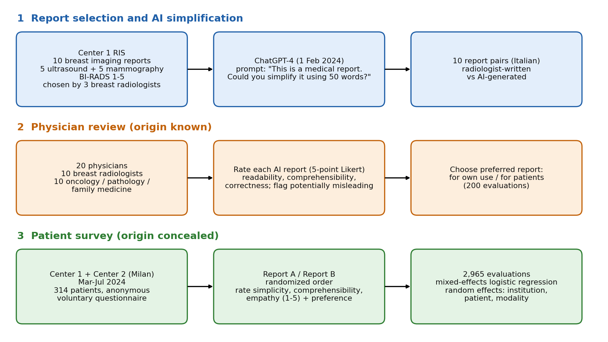

[Home](../) · [AI Papers](./)

# 病人 63.3% 選 AI 改寫的乳房報告，醫師只給 72%「正確」

## 來源

- 團隊：Università degli Studi di Milano（放射診斷專科學程；生物醫學、外科與牙醫科學系；腫瘤與血液腫瘤學系）、Fondazione IRCCS Ca' Granda Ospedale Maggiore Policlinico 放射科（中心 1）、IEO European Institute of Oncology IRCCS 乳房影像部（中心 2），以及 Institute of Integrated Diagnostics of Southern Switzerland（EOC，Lugano）、Ospedale A. Perrino（Brindisi）、Ospedale di Stato–ISS（San Marino）；共同第一作者 Veronica Magni、Matilde Pavan。[(ref: main)](https://link.springer.com/article/10.1186/s13244-026-02423-0)
- 論文：*Large language model–based simplification of breast imaging reports: a prospective multicentre study with 2965 patient-based evaluations*，*Insights into Imaging* 第 17 卷，article 273，2026 年 11 月 2 日刊出。[(ref: main)](https://link.springer.com/article/10.1186/s13244-026-02423-0)
- 識別碼：[DOI: 10.1186/s13244-026-02423-0](https://doi.org/10.1186/s13244-026-02423-0)。
- 全文：[出版社 HTML 全文](https://link.springer.com/article/10.1186/s13244-026-02423-0)（open access）；作者聲明支持結論的資料都在論文內，本研究未獲經費補助。[(ref: main)](https://link.springer.com/article/10.1186/s13244-026-02423-0)
- 研究性質：前瞻性、雙中心的問卷評估研究，不是 pilot；被評估的是現成的 ChatGPT-4 以一句 prompt 改寫報告，沒有微調或其他模型對照。病人端有 314 人、2,965 次評比並以 mixed-effects 迴歸附 95% CI，但所有評比都建立在同一組 10 份報告上；醫師端 200 次評比為描述性統計。[(ref: main)](https://link.springer.com/article/10.1186/s13244-026-02423-0) [(ref: main Table 5)](https://link.springer.com/article/10.1186/s13244-026-02423-0#Tab5)
- 證據邊界：本文數值取自正文文字；Table 2–5 的完整分層數值（各年齡層、各分數等級）與補充資料未納入本文引述，文中三張結果表為本書庫依正文整理。文中流程圖為本書庫依論文 Materials and methods 重繪，未轉載論文圖片。

**編輯：** Clare

這篇研究讓 ChatGPT-4 把 10 份義大利文乳房攝影與超音波報告各改寫成 50 字的白話版，請 20 位醫師在知道來源的情況下評品質、再請兩家米蘭乳房影像中心的 314 位病人在不知來源的情況下比較，病人在 2,965 次評比中有 63.3% 選 AI 版，醫師卻有 74.0% 自己偏好原報告、只有 72.0% 的 AI 版被評為至少「正確」，10.5% 被標為可能誤導。[(ref: main Abstract)](https://link.springer.com/article/10.1186/s13244-026-02423-0) [(ref: main Table 1)](https://link.springer.com/article/10.1186/s13244-026-02423-0#Tab1)

## 流程

圖：本書庫依論文 Materials and methods 重繪的研究設計示意圖，不含結果比例。圖分三列，每列左上方有編號 1 至 3 的彩色粗體標題，每列三個圓角方框以黑色實線箭頭由左至右相連。第一列（標題 1，藍色）：中心 1 放射資訊系統的 10 份乳房影像報告（超音波 5、乳房攝影 5，BI-RADS 1–5，由 3 位乳房放射科醫師挑選）、ChatGPT-4（2024 年 2 月 1 日）與 prompt 原文，以及 10 組義大利文報告配對（放射科醫師原報告對 AI 改寫版）。第二列（標題 2，橘色，origin known）：20 位醫師（10 位乳房放射科醫師、10 位腫瘤科／病理科／家醫科）、以 5 分 Likert 量表評 AI 版的 readability、comprehensibility、correctness 並標記是否可能誤導，以及選出自己使用與給病人時偏好的版本（200 次評比）。第三列（標題 3，綠色，origin concealed）：中心 1 與中心 2（米蘭）2024 年 3 至 7 月、314 位病人匿名自願填寫問卷，Report A／Report B 隨機順序並評 simplicity、comprehensibility、empathy（1–5）與偏好，以及 2,965 次評比與 mixed-effects logistic regression（隨機效應：institution、patient、modality）。[(ref: main Materials and methods)](https://link.springer.com/article/10.1186/s13244-026-02423-0)

## 背景／問題

作者的出發點是病人越來越常透過電子病歷入口直接讀到自己的影像報告。論文引言引用美國 21st Century Cures Act 後的病人取用趨勢，並引用文獻指出美國放射報告的閱讀難度約在 13 年級、而成人平均閱讀程度約 8 年級，另一篇引用則估計只有 4.2% 的放射報告達到這個可讀性門檻；這些是作者引用的背景，不是本研究量到的結果，本研究也沒有測量義大利文原報告的可讀性。[(ref: main Introduction)](https://link.springer.com/article/10.1186/s13244-026-02423-0)

作者另引用先前研究指出 ChatGPT-4 在翻譯放射術語、改寫乳房影像報告上有潛力，但認為那些研究多半只評估技術表現。本研究要回答的是：同一份報告的原文與 LLM 改寫版擺在一起時，病人如何評價兩者的 simplicity、comprehensibility 與 empathy、偏好哪一份，教育程度是否影響偏好；醫師端則補上 AI 版是否正確、是否可能誤導的判斷。病人是否「真的看懂」、看了之後焦慮或決策是否改變，都不在本研究的量測範圍內。[(ref: main Introduction)](https://link.springer.com/article/10.1186/s13244-026-02423-0) [(ref: main Discussion)](https://link.springer.com/article/10.1186/s13244-026-02423-0)

## 方法摘要

三位乳房放射科醫師從中心 1 的放射資訊系統挑出 10 份去識別報告（超音波與乳房攝影各 5 份，涵蓋 BI-RADS 1–5），2024 年 2 月 1 日以同一句 prompt 請 ChatGPT-4 各改寫成 50 字的簡化版，組成 10 組「原報告對 AI 版」配對。[(ref: main Materials and methods)](https://link.springer.com/article/10.1186/s13244-026-02423-0)

評估分兩端。醫師端：20 位醫師在知道哪份是 AI 版的情況下，逐份評 AI 版的可讀性、可理解性與正確性，標記是否可能誤導，並選出自己使用與給病人時各偏好哪一份。病人端：兩家米蘭乳房影像中心在 2024 年 3 至 7 月以候診區海報邀請成年受檢者匿名填答，兩份報告以 Report A／B 呈現、順序隨機、不揭露來源，病人評三個面向並選出偏好；最後以 mixed-effects 二元 logistic 迴歸分析哪些評分與偏好 AI 版有關。[(ref: main Materials and methods)](https://link.springer.com/article/10.1186/s13244-026-02423-0)

## 方法詳解

- **報告挑選** — 三位經驗 10 年以上的乳房放射科醫師從中心 1 的 Radiology Information System 回溯挑選 10 份「具代表性」的報告：超音波 5 份、乳房攝影 5 份，涵蓋 BI-RADS 1 至 5，挑出後去識別。所有報告都來自中心 1，中心 2 只提供病人填答者。[(ref: main Materials and methods)](https://link.springer.com/article/10.1186/s13244-026-02423-0)
- **LLM 與 prompt** — 使用 ChatGPT-4，於 2024 年 2 月 1 日輸入 prompt「This is a medical report. Could you simplify it using 50 words?」；50 字上限是為了讓兩版長度可比、問卷保持簡短。輸出只檢查格式與去識別問題。作者說明刻意使用最簡 prompt 以利重現，並認為更講究的 prompt engineering 可能改善品質。原報告與 AI 版都是義大利文。[(ref: main Materials and methods)](https://link.springer.com/article/10.1186/s13244-026-02423-0) [(ref: main Discussion)](https://link.springer.com/article/10.1186/s13244-026-02423-0)
- **醫師審閱** — 20 位醫師：10 位乳房放射科醫師，另 10 位來自腫瘤科、病理科與家醫科。他們同時看到每組配對的兩個版本、知道哪份是 AI 版，以 5 分 Likert 量表評 AI 版的 readability（simplicity）、comprehensibility、correctness，標記是否可能誤導，並回答自己使用時偏好哪一份、哪一份較適合給病人；20 人 × 10 份共 200 次評比（乳房攝影、超音波各 100）。[(ref: main Materials and methods)](https://link.springer.com/article/10.1186/s13244-026-02423-0) [(ref: main Table 1)](https://link.springer.com/article/10.1186/s13244-026-02423-0#Tab1)
- **病人問卷** — 候診區海報邀請接受乳房篩檢或診斷影像的成年病人向工作人員索取問卷、匿名交回；以匿名與自願參與為由，依資深作者所屬機構倫理委員會規定不需另行審查。每組配對以 Report A、Report B 呈現，順序隨機、不揭露來源；病人以 1（very low）至 5（very high）評 simplicity、comprehensibility、empathy，選出偏好的報告，並填性別、年齡區間與教育程度。[(ref: main Materials and methods)](https://link.springer.com/article/10.1186/s13244-026-02423-0)
- **統計** — 先做描述性統計，再以 Stata MP 19 的 melogit 做單變項與多變項 mixed-effects 二元 logistic 迴歸：結果變項為「偏好 AI 版」，固定效應為兩版各自的 simplicity、comprehensibility、empathy 評分與教育程度，隨機效應為 institution、patient、imaging modality；多變項模型只納入單變項 omnibus 檢定顯著者；缺值低於 2%，採 complete-case analysis；顯著水準 p < 0.05。[(ref: main Materials and methods)](https://link.springer.com/article/10.1186/s13244-026-02423-0) [(ref: main Table 5)](https://link.springer.com/article/10.1186/s13244-026-02423-0#Tab5)
- **論文未交代** — ChatGPT-4 的 temperature 等設定與是否在同一對話中改寫；AI 輸出除格式與去識別外是否經任何編輯，實際字數是否符合 50 字；10 份報告的挑選標準（只寫「representative」）與兩種檢查各自的 BI-RADS 分布；正文寫每位病人拿到一份原報告與一份 AI 版，但 2,965 次評比 ÷ 314 人約為每人 9.4 次，每人實際評了幾組、是否看過全部 10 組沒有說明；問卷是紙本或線上；醫師端 Likert 量表的錨點，以及「at least readable／comprehensible／correct」對應的分數門檻；21 次「可能誤導」的內容與分布；醫師端依專科、檢查別的分層，病人端依中心、檢查別的分層；Discussion 提到原報告 simplicity 4 分的 adjusted OR 0.56，Results 未列。

## 資料與實驗

下表整理論文的資料與評估角色。[(ref: main Materials and methods)](https://link.springer.com/article/10.1186/s13244-026-02423-0) [(ref: main Results)](https://link.springer.com/article/10.1186/s13244-026-02423-0)

| 資料 | 角色 | 規模與說明（論文所述） |
|---|---|---|
| 中心 1 報告（Fondazione IRCCS Ca' Granda Ospedale Maggiore Policlinico） | 改寫對象 | 10 份去識別義大利文報告：超音波 5、乳房攝影 5，涵蓋 BI-RADS 1–5 |
| AI 改寫版 | 被評估輸出 | ChatGPT-4（2024-02-01）以單一 prompt 各改寫為 50 字，共 10 份 |
| 醫師審閱者 | 品質與偏好評估（知道來源） | 20 位：乳房放射科 10、腫瘤科／病理科／家醫科 10；200 次評比（乳房攝影、超音波各 100） |
| 病人填答者 | 偏好與評分（不知來源） | 314 位：中心 1 194（61.8%）、中心 2 120（38.2%）；女性 299（95.2%）；45–75 歲 174（55.4%）；高中以上學歷 208（66.2%）；2024 年 3–7 月 |
| 病人評比 | 主要結果 | 2,965 次配對評比；迴歸分析 2,911 筆完整資料（排除 54 筆，1.8%） |

醫師對 AI 改寫版的評估（重製論文 Table 1 在正文列出的數值；分母為 200 次評比）。[(ref: main Table 1)](https://link.springer.com/article/10.1186/s13244-026-02423-0#Tab1)

| 項目 | n/200 | % |
|---|---|---|
| AI 版至少 readable | 169 | 84.5 |
| AI 版至少 comprehensible | 164 | 82.0 |
| AI 版至少 correct | 144 | 72.0 |
| AI 版可能誤導（potentially misleading） | 21 | 10.5 |
| 醫師自己偏好原報告 | 148 | 74.0 |
| 醫師判定 AI 版較適合給病人 | 162 | 81.0 |

病人評分為高分（4–5 分）的比例，原報告對 AI 版（依正文整理，對應論文 Table 4）。[(ref: main Table 4)](https://link.springer.com/article/10.1186/s13244-026-02423-0#Tab4)

| 面向 | AI 版 4–5 分 | 原報告 4–5 分 |
|---|---|---|
| Simplicity | 70.0% | 43.4% |
| Comprehensibility | 68.1% | 40.4% |
| Empathy | 51.2% | 33.7% |

病人偏好依 BI-RADS 分層（依正文整理；各類別的評比數為該類別兩欄相加）。[(ref: main Results)](https://link.springer.com/article/10.1186/s13244-026-02423-0) [(ref: main Fig. 1)](https://link.springer.com/article/10.1186/s13244-026-02423-0#Fig1)

| BI-RADS | 偏好 AI 版 | 偏好原報告 |
|---|---|---|
| 1 | 390（64.8%） | 212（35.2%） |
| 2 | 384（63.6%） | 220（36.4%） |
| 3 | 363（61.3%） | 229（38.7%） |
| 4 | 377（64.2%） | 210（35.8%） |
| 5 | 362（62.4%） | 218（37.6%） |

多變項 mixed-effects 迴歸中與偏好 AI 版相關的主要項目（依正文整理，對應論文 Table 5；括號為 95% CI；參考組依論文設定，正文未列）。[(ref: main Table 5)](https://link.springer.com/article/10.1186/s13244-026-02423-0#Tab5)

| 變項 | Unadjusted OR | Adjusted OR（95% CI） | p |
|---|---|---|---|
| AI 版 comprehensibility = 4 | 1.69（1.00–2.83） | 1.87（1.08–3.23） | 0.025 |
| AI 版 empathy = 4 | 1.74 | 1.63（1.00–2.66） | 0.051 |
| 原報告 comprehensibility = 4 | 0.37 | 0.45（0.29–0.69） | < 0.001 |
| 原報告 simplicity = 5 | 0.49 | 0.54（0.34–0.86） | 0.010 |
| 原報告 empathy = 4 | 0.40 | 0.58（0.38–0.88） | 0.010 |
| 教育程度（middle school 至 postgraduate） | 正文未列 | 1.02 至 1.72 | 皆不顯著 |

## 結果

- **病人偏好** — 2,965 次評比中 1,876 次（63.3%）選 AI 版、1,089 次（36.7%）選原報告；五個 BI-RADS 類別都是 AI 版較多，介於 61.3% 至 64.8%。[(ref: main Results)](https://link.springer.com/article/10.1186/s13244-026-02423-0)
- **病人評分** — AI 版在 simplicity、comprehensibility、empathy 拿到 4–5 分的比例都高於原報告（70.0% 對 43.4%、68.1% 對 40.4%、51.2% 對 33.7%）；作者描述評分差距在 BI-RADS 1–2 最明顯。[(ref: main Table 4)](https://link.springer.com/article/10.1186/s13244-026-02423-0#Tab4) [(ref: main Fig. 1)](https://link.springer.com/article/10.1186/s13244-026-02423-0#Fig1)
- **年齡分層** — 30 至 80 歲各年齡層偏好 AI 版的比例為 56.5% 至 75.2%；20 歲以下（63.3%）與 25–30 歲（56.2%）反而多數偏好原報告，20–25 歲偏好 AI 版者 80/149（53.7%）。[(ref: main Table 3)](https://link.springer.com/article/10.1186/s13244-026-02423-0#Tab3)
- **偏好與哪些評分相關** — AI 版 comprehensibility 評 4 分與偏好 AI 版相關（adjusted OR 1.87），AI 版 simplicity 評分則與偏好無關；原報告的 comprehensibility、simplicity、empathy 評分越高，越不偏好 AI 版，其中原報告 comprehensibility 4 分的關聯最強（adjusted OR 0.45）。教育程度的 adjusted OR 隨學歷由 1.02 升到 1.72，但都不顯著。[(ref: main Table 5)](https://link.springer.com/article/10.1186/s13244-026-02423-0#Tab5)
- **醫師評估** — 200 次評比中，AI 版被評為至少 readable 84.5%、至少 comprehensible 82.0%、至少 correct 72.0%，10.5% 被標為可能誤導；醫師自己使用時 74.0% 偏好原報告，但 81.0% 認為 AI 版較適合給病人。作者寫道沒有發現重大臨床錯誤，例如側別遺漏或 BI-RADS 寫錯，但沒有說明那 21 次「可能誤導」指的是什麼。[(ref: main Table 1)](https://link.springer.com/article/10.1186/s13244-026-02423-0#Tab1) [(ref: main Discussion)](https://link.springer.com/article/10.1186/s13244-026-02423-0)
- **作者結論** — 作者認為病人重視清楚易懂的語言，原報告的清楚度與 empathy 評分越高越不偏好 AI 版，顯示人的部分仍有價值；建議 AI 簡化版在發給病人前由合格放射科醫師審閱，並支持在監督下作為輔助使用。[(ref: main Discussion)](https://link.springer.com/article/10.1186/s13244-026-02423-0)

## 限制

- **作者自述** — 只測一個模型版本（2024 年 2 月 1 日的 ChatGPT-4），結果未必適用於其他或更新的模型；報告與改寫都是義大利文；量的是自評的可理解度與偏好，不是客觀理解；自願參與可能偏向健康識讀能力或數位能力較高的病人；只有 10 組報告配對，未必代表真實報告的多樣性。[(ref: main Discussion)](https://link.springer.com/article/10.1186/s13244-026-02423-0)
- **本書庫補充：2,965 次評比的有效樣本是 10 份報告** — 病人與評比數很多，但內容只有 10 組配對、全部出自同一中心；迴歸的隨機效應包含 institution、patient、modality，沒有把「報告」本身列為隨機效應，所以 95% CI 反映的是病人之間的變異，不涵蓋換一批報告時結論會不會變。五個 BI-RADS 類別的評比數相近（580–604 次），10 份報告平均分到每個類別只有約兩份。[(ref: main Materials and methods)](https://link.springer.com/article/10.1186/s13244-026-02423-0) [(ref: main Table 5)](https://link.springer.com/article/10.1186/s13244-026-02423-0#Tab5)
- **本書庫補充：病人偏好與正確性是分開量的** — 病人評的是讀起來簡不簡單、懂不懂、有沒有同理心，不判斷內容對不對；醫師端只有 72.0% 的 AI 版被評為至少正確、10.5% 可能誤導，而這些評比是在知道來源的情況下做的。病人偏好 AI 版，不代表病人拿到的資訊比較正確。[(ref: main Table 1)](https://link.springer.com/article/10.1186/s13244-026-02423-0#Tab1) [(ref: main Materials and methods)](https://link.springer.com/article/10.1186/s13244-026-02423-0)
- **本書庫補充：比較的兩版設計目標不同** — 原報告是寫給臨床醫師的完整報告，AI 版被限制在 50 字且明確要求簡化；本研究沒有對照「放射科醫師自己寫的病人版摘要」或其他簡化方法，所以結果回答的是「白話短版對原報告」，不是「LLM 對人工簡化」。[(ref: main Materials and methods)](https://link.springer.com/article/10.1186/s13244-026-02423-0)
- **本書庫補充：模型與研究時間** — 改寫在 2024 年 2 月完成、問卷在 2024 年 3 至 7 月收集，論文刊出於 2026 年 11 月；所測的 ChatGPT-4 版本與今日可用的模型已有差距，結果的方向與量級都不能直接套用到新模型。[(ref: main)](https://link.springer.com/article/10.1186/s13244-026-02423-0)

## 與書庫其他文章的關係

兩篇都讓 LLM 只處理放射報告文字，但方向相反：雲南兩院那篇讓 LLM 替放射科醫師找出既有報告裡的錯，本篇讓 LLM 把報告改寫給病人看，醫師判定只有 72.0% 的改寫版至少正確、10.5% 可能誤導，正好是前一篇那類文字品管可以接手檢查的輸出: [14 萬份中文報告挑錯：Qwen3 recall 0.96，醫師最高 0.67](2026-11-02-llm-radiology-report-error-qa-multicenter.md)

## 實務的啟發

這是一篇病人人數不少、設計上有盲化與隨機順序的偏好研究，但被評估的內容只有 10 份報告、一個 2024 年初的模型版本與一句 prompt。它支持的是「病人傾向選擇白話短版」這個方向，不足以支持「LLM 簡化版可以直接發給病人」，作者自己也建議發送前由放射科醫師審閱。

第一，可借用的是把「病人偏好」與「內容正確」分開量的雙端設計：病人端盲化比較易讀性與偏好，醫師端另評正確性與是否可能誤導。本篇的數字正好說明為什麼兩端都要有——病人有 63.3% 選 AI 版，醫師評為至少正確的只有 72.0%。院內若要試行病人版報告，量測表至少要同時包含這兩類指標。[(ref: main Results)](https://link.springer.com/article/10.1186/s13244-026-02423-0) [(ref: main Table 1)](https://link.springer.com/article/10.1186/s13244-026-02423-0#Tab1)

第二，這篇留下的是待驗證的警訊而不是做法：10.5% 可能誤導的比例來自醫師在知道來源下的判斷，論文沒有說明誤導的類型。本書庫認為，要把簡化版放進病人入口之前，需要在更多份、涵蓋各 BI-RADS 類別的報告上，以盲化方式逐句比對改寫版與原報告的事實是否一致，並記錄錯誤類型；本研究的設計還做不到這一步。[(ref: main Discussion)](https://link.springer.com/article/10.1186/s13244-026-02423-0)

第三，迴歸結果提示原報告本身寫得清楚，病人就比較不需要 AI 版（原報告 comprehensibility 4 分的 adjusted OR 0.45）。本書庫認為這意味著改善原報告的寫法與加上 AI 白話版可以並行評估，但論文沒有直接比較這兩條路。[(ref: main Table 5)](https://link.springer.com/article/10.1186/s13244-026-02423-0#Tab5)

## References

- **main** — Magni V, Pavan M, et al. *Large language model–based simplification of breast imaging reports: a prospective multicentre study with 2965 patient-based evaluations.* Insights into Imaging. 2026;17:273. DOI: [10.1186/s13244-026-02423-0](https://doi.org/10.1186/s13244-026-02423-0)。出版社全文：<https://link.springer.com/article/10.1186/s13244-026-02423-0>。本文使用的深鏈：[Table 1](https://link.springer.com/article/10.1186/s13244-026-02423-0#Tab1)、[Table 3](https://link.springer.com/article/10.1186/s13244-026-02423-0#Tab3)、[Table 4](https://link.springer.com/article/10.1186/s13244-026-02423-0#Tab4)、[Table 5](https://link.springer.com/article/10.1186/s13244-026-02423-0#Tab5)、[Fig. 1](https://link.springer.com/article/10.1186/s13244-026-02423-0#Fig1)；Abstract、Introduction、Materials and methods、Results、Discussion 各節在出版社頁沒有獨立錨點，連到全文頁。

[Home](../) · [AI Papers](./)
